| Mục | Nội dung |
|---------------|--------------------------------------------------|
| **Loại tài liệu** | Tài liệu yêu cầu sản phẩm – **bản chính thức, căn cứ duy nhất** để lập trình, kiểm thử và nghiệm thu. Mọi thay đổi phạm vi phải sửa tài liệu này trước khi sửa code. |
| **Sản phẩm** | Mobile App (React Native/Expo) · Web User (React) · Web Admin (React) · Backend Node.js + SQL Server · CI/CD (GitHub Actions) |
| **Trọng tâm** | Frontend Web và Mobile: định vị GPS, bản đồ, trình phát, đa ngôn ngữ, hoạt động offline, realtime; kèm quy trình CI/CD. |
| **Nhóm** | Lương Diệu Quang · Võ Thị Ngọc Như |
| **Kho mã nguồn** | github.com/quangdieuluong2006-ctrl/CNPM_DinhDocLap (nhánh develop, main) |
| **Phiên bản** | 2.0 – 01/11/2026 |
| **Trạng thái** | **Đã chốt.** Không thêm tính năng ngoài danh sách FE-01 → FE-24. |

## Lịch sử thay đổi

| Phiên bản | Ngày | Nội dung |
|---------------|---------------------------|--------------------------------------------------|
| 1.0 | 22/10/2026 | Bản đầu tiên cho chủ đề thuyết minh du lịch theo vị trí. |
| 1.1 | 27/10/2026 | Khách ẩn danh không cần đăng ký; tạm bỏ nhóm tham quan; giao diện theo 10 ngôn ngữ; QR mời tham gia qua Cloudflare Tunnel. |
| **2.0** | 01/11/2026 | **Bản chính thức sạch.** Viết lại toàn bộ theo sản phẩm thật sau buổi kiểm tra giữa kỳ (28/10): (1) bỏ hẳn nhóm tham quan và vai trò hướng dẫn viên khỏi tài liệu, CSDL (migration 004) và API; chỉ còn 2 vai trò `user` và `admin`. (2) Dùng lại mã trống: **FE-10** = Lịch sử tham quan trên Mobile, **FE-23** = Mời khách tham gia bằng QR; **UC-10** = Mời khách tham gia bằng QR, **UC-11** = Xem tiến độ và điểm gợi ý → 24 tính năng, 20 use case liên tục. (3) **Giọng đọc AI**: 120 tệp MP3 (12 điểm × 10 ngôn ngữ) sinh bằng giọng neural, nạp sẵn khi seed. (4) Bổ sung sơ đồ lớp Mobile, lưu đồ quét QR, ảnh chụp giao diện thật. (5) CD: phát hành bằng tag `v*` (bản build Web, Docker image API, APK). (6) Kế hoạch hoàn thiện 2 tuần trước báo cáo cuối kỳ. |

## Cách đọc tài liệu

- **Mục 1–3:** sản phẩm giải quyết vấn đề gì, cho ai, gồm những tính năng nào.
- **Mục 4:** kiến trúc và các cơ chế cốt lõi (kích hoạt theo vị trí, QR, trình phát, offline, khách ẩn danh, presence, giọng AI) – phần quan trọng nhất khi lập trình.
- **Mục 5–7:** đặc tả từng tính năng (FE-xx) kèm tiêu chí chấp nhận (AC).
- **Mục 8–9:** use case, sơ đồ tuần tự, sơ đồ trạng thái.
- **Mục 10–13:** giao diện, API, realtime, cơ sở dữ liệu – hợp đồng giữa Frontend và Backend.
- **Mục 14–17:** yêu cầu phi chức năng, bảo mật, CI/CD, kiểm thử.
- **Mục 18 và phụ lục:** kế hoạch hoàn thiện, phân công, rủi ro, dữ liệu mẫu, hằng số, kịch bản trình diễn.

**Quy ước.** **Phải** = bắt buộc; **Nên** = làm nếu còn thời gian; **Giai đoạn 2** = ngoài phạm vi đồ án. Mỗi đặc tả có dòng **Hiện trạng** ghi rõ *Đã có* hoặc *Cần làm* (việc còn lại trong 2 tuần, xem mục 18). Mã FE-xx (tính năng), UC-xx (use case), SD-xx (sơ đồ tuần tự), TC-xx (test case), NFR-xx (yêu cầu phi chức năng) dùng xuyên suốt để truy vết; mã FE được ghi trong chú thích code.

## Danh mục hình

| Hình | Nội dung | Tệp nguồn (docs/diagrams) |
|---------------|-------------------------------------------|-----------------------------------------|
| 1 | Bối cảnh hệ thống và các tác nhân | context.puml |
| 2 | Sơ đồ thành phần hệ thống | components.puml |
| 3 | Sơ đồ lớp lõi Mobile | class_mobile.puml |
| 4 | Máy trạng thái vùng kích hoạt | st_geofence.puml |
| 5 | Lưu đồ xử lý mỗi mẫu vị trí | act_geofence.puml |
| 6 | Lưu đồ quét QR / nhập số điểm | act_qr.puml |
| 7 | Sơ đồ use case tổng quát | uc.puml |
| 8–12 | Sơ đồ tuần tự SD-01 → SD-05 | sd01–sd05.puml |
| 13 | Máy trạng thái bài thuyết minh | st_content.puml |
| 14–17 | Giao diện thật: Mobile, Web User, Web Admin | ui_*.png (chụp màn hình) |
| 18 | Sơ đồ quan hệ thực thể (ERD) | erd.puml |
| 19 | Quy trình CI/CD | cicd.puml |
| 20 | Vị trí các điểm ngoài trời | map_points.png |

Sơ đồ viết bằng PlantUML; sửa tệp `.puml` rồi xuất lại PNG: `java -jar plantuml.jar -charset UTF-8 -tpng docs/diagrams/*.puml`.

# Tổng quan sản phẩm

## Bối cảnh

Dinh Độc Lập (135 Nam Kỳ Khởi Nghĩa, phường Bến Thành, TP. Hồ Chí Minh) là di tích quốc gia đặc biệt, đón đông khách trong nước và quốc tế. Mỗi khu vực ngoài trời và mỗi phòng trong tòa nhà gắn với một câu chuyện lịch sử hoặc kiến trúc riêng. Hiện khách tiếp cận thông tin qua ba cách, cách nào cũng có hạn chế:

| Cách hiện tại | Hạn chế |
|-----------------------------|--------------------------------------------------|
| **Bảng giới thiệu tại chỗ** | Ít ngôn ngữ; chữ nhỏ, đông người khó đọc; không phù hợp người khiếm thị, trẻ em. |
| **Hướng dẫn viên** | Chi phí cao, phải đi theo đoàn và theo lịch; không đủ người cho mọi ngôn ngữ. |
| **Máy thuyết minh thuê tại quầy** | Phải xếp hàng thuê và trả; thiết bị dùng chung; nội dung cập nhật chậm; khách tự bấm số. |

## Giải pháp

Ứng dụng thuyết minh đa ngôn ngữ chạy trên **chính điện thoại của khách**:

- **Ngoài trời:** dùng GPS, **tự phát bài thuyết minh** khi khách đi vào vùng của một điểm (cổng chính, xe tăng, bãi cỏ, mặt tiền…).
- **Trong nhà:** GPS không phân biệt được phòng và tầng, nên mỗi phòng có **mã QR và số điểm**; khách quét mã hoặc nhập số để nghe.
- **Đa ngôn ngữ:** 10 ngôn ngữ; mỗi bài có **tệp giọng đọc AI** (giọng neural) và văn bản đi kèm; thiết bị dùng giọng tổng hợp (TTS) khi chưa có tệp.
- **Không cần mạng khi tham quan:** tải trước nội dung và âm thanh của ngôn ngữ đã chọn.
- **Không đăng ký, không đăng nhập:** quét QR là dùng ngay; hệ thống tự tạo **khách ẩn danh** để vẫn đếm được người đang hoạt động và lưu lịch sử.
- **Web User:** nghe thuyết minh ngay trên trình duyệt (khi chưa cài ứng dụng), xem trước/sau chuyến đi.
- **Web Admin:** ban quản lý thêm/sửa điểm, tọa độ, nội dung từng ngôn ngữ, tệp âm thanh; theo dõi khách đang hoạt động theo thời gian thực; in mã QR.

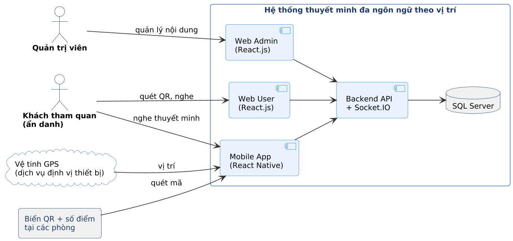

## Mục tiêu và chỉ số thành công

| Mục tiêu | Chỉ số đo | Ngưỡng |
|--------------------------------|--------------------------------------------------|----------------------------------|
| Nghe đúng điểm, đúng lúc | Thời gian từ khi vào vùng đến khi bắt đầu phát | ≤ 3 giây (GPS tốt hoặc mô phỏng) |
| Không phát nhầm điểm | Số lần phát sai trong kịch bản 12 điểm | 0 với mô phỏng; ≤ 1/12 khi đi thật |
| Phục vụ khách quốc tế | Số ngôn ngữ có đủ bài và tệp giọng đọc cho 12 điểm | 10 ngôn ngữ, 120 tệp âm thanh |
| Dùng được khi mất mạng | Phát nội dung đã tải ở chế độ máy bay | 100% điểm của ngôn ngữ đã tải |
| Quản lý không cần lập trình viên | Thêm một điểm mới kèm bài 1 ngôn ngữ trên Web Admin | ≤ 5 phút |
| Theo dõi vận hành | Độ trễ cập nhật số khách đang hoạt động trên Web Admin | ≤ 3 giây |
| Chất lượng phát triển | Pull Request chạy CI xanh và được người còn lại duyệt trước khi gộp | 100% PR vào develop/main |

## Phạm vi

### Trong phạm vi đồ án

| Nền tảng | Phạm vi |
|-------------------------------|--------------------------------------------------|
| **Mobile (React Native/Expo)** | Khách ẩn danh tự động · chọn ngôn ngữ (tìm kiếm) · bản đồ, danh sách, chi tiết điểm · tự động thuyết minh theo GPS (khi ứng dụng đang mở) · quét QR / nhập số điểm · trình phát (tệp âm thanh hoặc TTS) · tải offline · tiến độ và điểm gợi ý · lịch sử tham quan · cài đặt · chế độ mô phỏng vị trí |
| **Web User (React)** | Trang chủ, danh sách điểm, tìm kiếm, lọc · chi tiết điểm và nghe · bản đồ khuôn viên · lịch sử tham quan · khách ẩn danh tự động |
| **Web Admin (React)** | Dashboard · quản lý người dùng (online/offline, khóa/mở) · khách đang hoạt động theo thời gian thực · mời khách bằng QR · quản lý điểm trên bản đồ · nội dung đa ngôn ngữ và âm thanh · ngôn ngữ · nhật ký · in mã QR |
| **Backend** | REST API + Socket.IO (Node.js, Express 5, TypeScript) · SQL Server 2022 (migration, view, stored procedure) · lưu và phát tệp (HTTP Range) · Swagger · script sinh giọng đọc AI |
| **CI/CD** | CI cho api, web, admin, mobile, docs ở mọi Pull Request · kiểm thử E2E · phát hành bằng tag `v*`: bản build Web, Docker image API, APK |

### Ngoài phạm vi (giai đoạn 2)

- Tự thuyết minh khi ứng dụng **chạy nền** hoặc tắt màn hình (cần quyền vị trí nền, development build).
- Định vị trong nhà bằng Bluetooth beacon / Wi-Fi; nhận diện tầng.
- Nhóm tham quan có hướng dẫn viên (đã thiết kế ở v1.0, bỏ hẳn từ v2.0).
- Tài khoản khách có email/mật khẩu; mua vé, đặt lịch, thanh toán.
- Dịch máy và sinh giọng đọc **ngay trong Web Admin** (v2.0 sinh giọng bằng script ngoài, mục 4.10).
- Nhiều di tích (mô hình dữ liệu cho phép mở rộng, mục 13.5); thông báo đẩy; bản đồ trong nhà theo tầng.

## Thuật ngữ

| Thuật ngữ | Giải thích |
|------------------------------------------|--------------------------------------------------|
| **Điểm thuyết minh (Point of Interest – POI)** | Một khu vực ngoài trời hoặc một phòng có bài thuyết minh. Mỗi điểm có **số điểm** 3 chữ số (ví dụ 201) in trên biển. |
| **Vùng kích hoạt (geofence)** | Hình tròn tâm là tọa độ điểm, bán kính tính bằng mét; khách đi vào thì ứng dụng tự phát. |
| **Kiểu kích hoạt** | `gps` – tự động theo vùng (ngoài trời); `indoor` – bằng QR hoặc số điểm (trong nhà). |
| **Bài thuyết minh** | Nội dung một điểm ở một ngôn ngữ: tiêu đề, tóm tắt, văn bản, tệp âm thanh. |
| **Giọng đọc AI (neural TTS)** | Tệp MP3 sinh trước bằng giọng tổng hợp thần kinh chất lượng cao, phát như bản thu âm. |
| **Giọng tổng hợp thiết bị (TTS)** | Giọng máy của điện thoại/trình duyệt đọc văn bản trực tiếp; dùng khi bài chưa có tệp âm thanh. |
| **Gói nội dung (content bundle)** | Toàn bộ điểm + bài của một ngôn ngữ, có số phiên bản; tải về để dùng offline. |
| **Lượt ghé (visit)** | Bản ghi khi khách nghe một điểm: cách kích hoạt, thời lượng đã nghe, đã nghe hết hay chưa. |
| **Khách ẩn danh (guest)** | Tài khoản do hệ thống tự tạo khi khách mở ứng dụng lần đầu (`is_guest = 1`, tên "Khách #XXXX", không mật khẩu). |
| **Người dùng đang hoạt động (presence)** | Người có kết nối realtime chưa đóng và gửi nhịp tim trong 60 giây gần nhất. |
| **Chế độ mô phỏng vị trí** | Thay GPS thật bằng vị trí giả (chạm bản đồ hoặc lộ trình mẫu) để kiểm thử và trình diễn. |

## Tài liệu tham khảo

- Expo SDK 58: expo-location, expo-audio, expo-speech, expo-camera, expo-file-system, expo-secure-store, expo-localization.
- React 19, Vite 8, React Router, TanStack Query, Tailwind CSS 4, Leaflet/OpenStreetMap; react-native-maps.
- Microsoft SQL Server 2022; node-mssql; Express 5; Socket.IO 4; OpenAPI 3.1.
- ISO 639-1 (mã ngôn ngữ), BCP 47 (locale giọng đọc).
- Thông tin lịch sử: trang chính thức của Di tích Dinh Độc Lập và bảng thuyết minh tại chỗ – **bắt buộc đối chiếu trước khi duyệt nội dung** (mục 15.4).

# Người dùng và phân quyền

## Chân dung người dùng (persona)

| Persona | Mô tả | Nhu cầu chính | Nền tảng |
|--------------------------------------------|--------------------------------------------------|--------------------------------------------------|-----------------|
| Khách lẻ quốc tế – "Emily", 28 tuổi | Tự tham quan, không biết tiếng Việt, sim du lịch chập chờn | Nghe tiếng Anh tự động, không thuê máy, dùng được khi mất mạng | Mobile |
| Khách lớn tuổi – "Cô Lan", 55 tuổi | Đi cùng đoàn, ít dùng công nghệ | Quét QR là nghe ngay, không đăng ký; thao tác ít, chữ to | Web User, Mobile |
| Sinh viên chuẩn bị chuyến đi – "Hà", 20 tuổi | Muốn tìm hiểu trước khi đến | Đọc/nghe nội dung trên máy tính, tìm theo tên phòng | Web User |
| Biên tập viên – "Chị Thu" | Nhân viên ban quản lý di tích | Thêm điểm, sửa nội dung, tải âm thanh, duyệt bản dịch, in QR | Web Admin |
| Quản trị hệ thống – "Anh Tuấn" | Phụ trách vận hành | Theo dõi khách đang hoạt động, lượt tham quan, khóa tài khoản vi phạm | Web Admin |

## Vai trò và quyền

Hệ thống có **2 vai trò** (`users.role`): `user` và `admin`. Khách không đăng ký: lần đầu mở Web User hoặc Mobile, API tự tạo một tài khoản `user` có `is_guest = 1`. Chỉ Quản trị viên có email/mật khẩu và đăng nhập Web Admin. "Người kiểm thử" trong sơ đồ use case là vai trò nghiệp vụ (người dùng chế độ mô phỏng), không phải một giá trị `role`.

| Chức năng | Khách (user, is_guest) | Quản trị viên (admin) |
|------------------------------------------------|----------------------|---------------------|
| Xem điểm, nghe thuyết minh, tải offline | ✓ | ✓ |
| Tự động thuyết minh, quét QR, nhập số điểm | ✓ | ✓ |
| Lưu tiến độ, lịch sử tham quan (đồng bộ máy chủ) | ✓ | ✓ |
| Đăng nhập Web Admin | – | ✓ |
| Quản lý điểm, nội dung, ngôn ngữ, in QR | – | ✓ |
| Xem khách đang hoạt động, mời khách bằng QR | – | ✓ |
| Quản lý người dùng, khóa/mở tài khoản | – | ✓ |

> **Quyết định:** Khách dùng mọi tính năng cốt lõi **không cần tài khoản** để giảm rào cản. Kiểm tra quyền luôn ở Backend (middleware `requireAuth`, `requireRole("admin")`); giao diện chỉ ẩn nút.

## Hành trình người dùng chính

### Khách lẻ dùng ứng dụng

1. Tại cổng, quét mã QR trên biển "Nghe thuyết minh miễn phí" → mở Web User hoặc trang tải ứng dụng.
2. Mở ứng dụng → "Bắt đầu tham quan" (hệ thống tự tạo khách) → chọn ngôn ngữ (gõ "English" hoặc "Anh").
3. Cấp quyền vị trí → bản đồ hiện các điểm và vị trí của khách; Cài đặt → tải nội dung offline.
4. Đi vào vùng "Cổng chính" → rung nhẹ, thẻ điểm hiện lên, bài tự phát.
5. Vào trong tòa nhà → tại mỗi phòng quét QR hoặc nhập số điểm → nghe bài của phòng.
6. Tab Điểm: "Đã nghe 9/12 điểm", điểm gợi ý tiếp theo; Lịch sử tham quan liệt kê các điểm đã nghe.

### Khách chưa cài ứng dụng

1. Quét QR trên biển phòng 201 bằng camera điện thoại → mở `https://<web-user>/p/201`.
2. Trang tự tạo khách ẩn danh, hiện bài theo ngôn ngữ trình duyệt; bấm Nghe.
3. Web Admin thấy thêm một khách đang hoạt động trong ≤ 3 giây.

### Quản trị viên mời khách trong buổi trình diễn

1. Web Admin → Đang hoạt động → **Mời tham gia (QR)** → hiện mã QR tới Web User (địa chỉ công khai/tunnel/Wi-Fi).
2. Bốn khách quét QR bằng điện thoại → mỗi máy là một khách riêng → bảng Đang hoạt động hiện 4 dòng.

### Biên tập viên thêm một điểm mới

1. Web Admin → Điểm thuyết minh → "Thêm điểm".
2. Nhập tên nội bộ, số điểm, khu vực, kiểu kích hoạt; điểm ngoài trời: nhấp bản đồ để chọn tọa độ, chỉnh bán kính.
3. Nhập bài tiếng Việt, nghe thử, tải tệp âm thanh (tùy chọn).
4. Thêm bài các ngôn ngữ khác (chờ duyệt) → duyệt → phiên bản nội dung tăng → ứng dụng nhận bản mới.

# Danh sách tính năng

Ưu tiên theo MoSCoW: **Phải** (Must), **Nên** (Should). Cột Hiện trạng: *Đã có* = đã chạy trên develop; *Cần làm* = thuộc kế hoạch 2 tuần (mục 18).

| Mã | Tính năng | Nền tảng | Ưu tiên | Tóm tắt | Hiện trạng |
|---------------|---------------------------------|-----------------|------------|--------------------------------------------------|-----------------------------|
| FE-01 | Khách ẩn danh | Mobile | Phải | Không đăng ký/đăng nhập; tự tạo khách, khôi phục đúng khách cũ khi mở lại. | Đã có |
| FE-02 | Chọn ngôn ngữ thuyết minh | Mobile | Phải | Danh sách có tìm kiếm theo tên Việt, bản ngữ, tiếng Anh, mã ISO; giao diện đổi theo. | Đã có |
| FE-03 | Bản đồ khuôn viên | Mobile | Phải | Vị trí khách, các điểm, vùng kích hoạt; nút Quét mã. | Đã có |
| FE-04 | Danh sách và chi tiết điểm | Mobile | Phải | Theo khu vực, tìm kiếm, khoảng cách, dấu đã nghe; chi tiết có ảnh. | Đã có |
| FE-05 | Tự động thuyết minh theo GPS | Mobile | Phải | Vào vùng điểm ngoài trời → tự phát (ứng dụng đang mở); thêm rung. | Đã có; *rung: cần làm* |
| FE-06 | Kích hoạt trong nhà: QR / số điểm | Mobile | Phải | Quét QR hoặc nhập 3 chữ số → mở và phát bài. | Đã có |
| FE-07 | Trình phát thuyết minh | Mobile | Phải | Phát/tạm dừng, phát lại, tua ±10 s, tốc độ, đổi ngôn ngữ, văn bản kèm. | Đã có |
| FE-08 | Tải trước nội dung (offline) | Mobile | Phải | Gói nội dung + tệp âm thanh; kiểm tra phiên bản; gửi lượt ghé bù. | Đã có |
| FE-09 | Tiến độ và điểm gợi ý | Mobile | Nên | "Đã nghe x/12", điểm tiếp theo kèm khoảng cách và hướng. | Đã có; *màn chúc mừng: cần làm* |
| FE-10 | Lịch sử tham quan (Mobile) | Mobile | Nên | Danh sách điểm đã nghe theo thời gian, cách kích hoạt. | *Cần làm* |
| FE-11 | Chế độ mô phỏng vị trí | Mobile | Phải | Chạm bản đồ hoặc chạy lộ trình mẫu. | Đã có |
| FE-12 | Cài đặt | Mobile | Phải | Ngôn ngữ, tự động phát, rung, cỡ chữ, dữ liệu offline, máy chủ API. | Đã có; *rung, cỡ chữ: cần làm* |
| FE-13 | Trang chủ và danh sách điểm | Web User | Phải | Giới thiệu, chọn ngôn ngữ, danh sách, tìm kiếm, lọc khu vực. | Đã có |
| FE-14 | Chi tiết điểm và nghe thuyết minh | Web User | Phải | Đọc bài, nghe tệp âm thanh hoặc giọng trình duyệt; đích của QR. | Đã có |
| FE-15 | Bản đồ khuôn viên (web) | Web User | Nên | Leaflet + OpenStreetMap. | Đã có |
| FE-16 | Lịch sử tham quan (web) | Web User | Phải | Điểm đã nghe của khách ẩn danh trên trình duyệt này. | Đã có |
| FE-17 | Dashboard | Web Admin | Phải | Thẻ số liệu, biểu đồ 7 ngày, top điểm, ngôn ngữ, hoạt động gần đây. | Đã có |
| FE-18 | Quản lý người dùng | Web Admin | Phải | Danh sách, online/offline, hoạt động gần nhất, lịch sử phiên; khóa/mở. | Đã có |
| FE-19 | Người dùng đang hoạt động | Web Admin | Phải | Số và danh sách realtime, một người nhiều thiết bị tính 1. | Đã có |
| FE-20 | Quản lý điểm thuyết minh | Web Admin | Phải | Thêm/sửa/ẩn/xóa; tọa độ trên bản đồ, bán kính, ảnh, thứ tự. | Đã có |
| FE-21 | Nội dung đa ngôn ngữ và âm thanh | Web Admin | Phải | Soạn bài từng ngôn ngữ, tải tệp, nghe thử, duyệt, xuất bản. | Đã có |
| FE-22 | Quản lý ngôn ngữ | Web Admin | Phải | Thêm từ danh mục ISO, bật/tắt, mức hoàn thiện. | Đã có |
| FE-23 | Mời khách tham gia bằng QR | Web Admin | Phải | Mã QR tới Web User: địa chỉ công khai → tunnel → IP Wi-Fi. | Đã có; *sửa dòng hướng dẫn* |
| FE-24 | Nhật ký và in mã QR | Web Admin | Phải | Nhật ký thao tác; trang in QR + số điểm cho các phòng. | Đã có |

> **Lưu ý:** Mobile là phần quan trọng nhất (FE-01 → FE-12). Web User dùng chung API và hệ thiết kế với Mobile; Web Admin là nơi duy nhất sửa nội dung mà Mobile và Web User hiển thị.

# Kiến trúc và các cơ chế cốt lõi

## Kiến trúc tổng thể

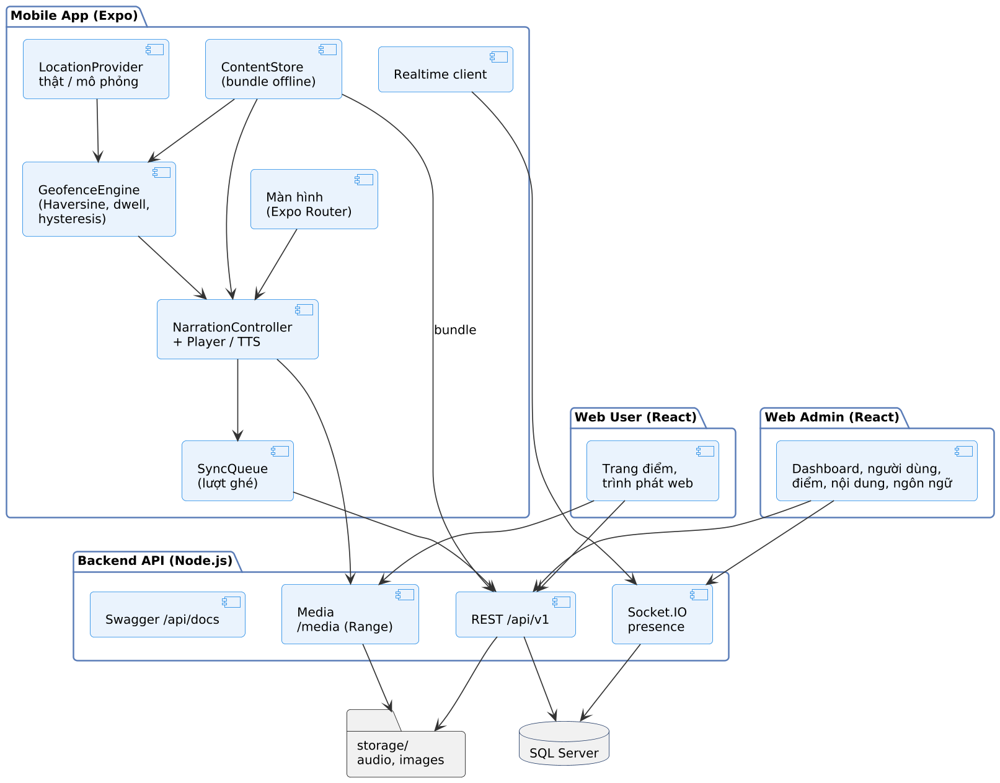

| Thành phần | Vai trò | Công nghệ (đúng theo package.json) |
|------------------------|--------------------------------------------------|--------------------------------------------------|
| **Mobile App** (`mobile/`) | Ứng dụng chính của khách: GPS, bản đồ, trình phát, offline | Expo SDK 58, React Native 0.88, React 19, TypeScript, expo-router; trạng thái bằng **AppStore** tự viết (useSyncExternalStore); i18n tự viết 10 ngôn ngữ; expo-location, expo-audio, expo-speech, expo-camera, expo-file-system, expo-secure-store, AsyncStorage, react-native-maps, socket.io-client; Vitest |
| **Web User** (`web/`) | Nghe thuyết minh trên trình duyệt; đích của mã QR | React 19 + Vite 8, TypeScript, React Router, TanStack Query, Tailwind CSS 4, Leaflet + OpenStreetMap, Web Speech API, lucide-react; Vitest |
| **Web Admin** (`admin/`) | Quản lý nội dung, người dùng, vận hành | React 19 + Vite 8, TypeScript, TanStack Query, Tailwind CSS 4, Recharts, Leaflet, qrcode; Vitest + Testing Library |
| **Backend API** (`api/`) | REST + realtime, xác thực, phân quyền, lưu tệp | Node.js 22, Express 5, TypeScript, Socket.IO 4, zod, mssql, multer, helmet, express-rate-limit, pino, bcryptjs, jsonwebtoken, Swagger UI; Vitest + supertest |
| **Cơ sở dữ liệu** (`db/`) | Người dùng, phiên, điểm, nội dung, lượt ghé, nhật ký | SQL Server 2022 (migration .sql, view, stored procedure) |
| **Lưu trữ tệp** | Âm thanh, ảnh điểm | Thư mục `storage/` của API, phục vụ tại `/media/...` |
| **CI/CD** | Kiểm tra mỗi PR, phát hành | GitHub Actions, GHCR (Docker image API), EAS Build (APK), GitHub Releases |

### Nguyên tắc thiết kế

- **Quyết định "phát hay không" nằm ở Mobile**, không gửi tọa độ liên tục lên máy chủ: phản hồi nhanh, chạy offline, tiết kiệm pin, bảo vệ quyền riêng tư.
- **Máy chủ chỉ nhận sự kiện có nghĩa:** lượt ghé và nhịp tim presence.
- **Một nguồn nội dung:** Mobile và Web User đọc cùng API/gói nội dung; chỉ Web Admin được sửa.
- **Nguồn vị trí thay thế được** (`LocationProvider`): GPS thật hoặc mô phỏng, logic phía trên không phân biệt (mục 4.8).
- **Mọi yêu cầu phát đi qua một bộ điều phối** (`NarrationController`): không bao giờ có hai bài phát chồng nhau.

### Cấu trúc lõi Mobile

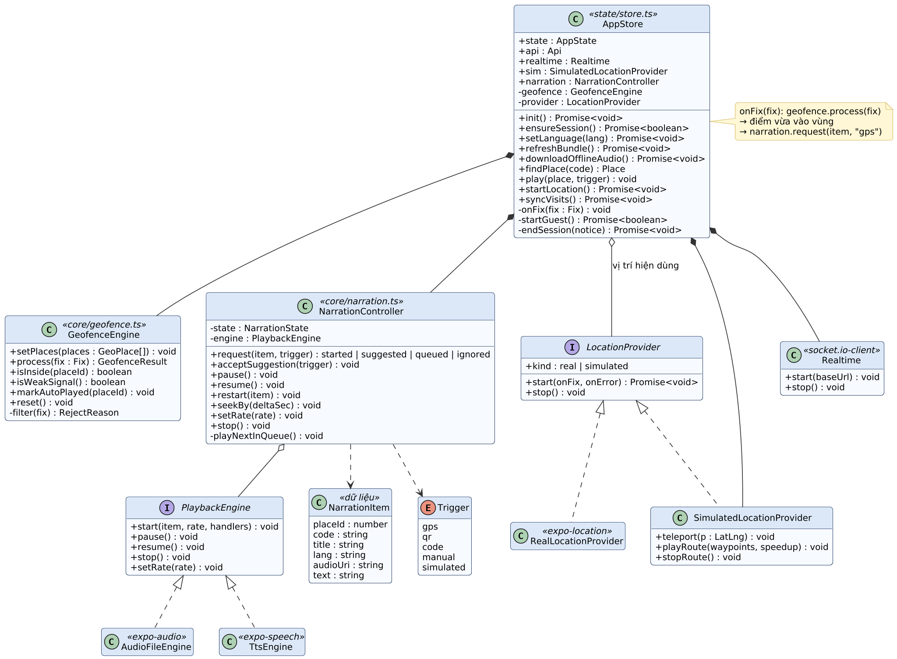

| Lớp (tệp) | Trách nhiệm |
|-----------------------------------------|--------------------------------------------------|
| `AppStore` (state/store.ts) | Trạng thái toàn ứng dụng: phiên khách, ngôn ngữ, gói nội dung, lượt ghé chờ gửi; nối các thành phần dưới đây. |
| `GeofenceEngine` (core/geofence.ts) | Lọc mẫu vị trí, máy trạng thái mỗi điểm, trả về điểm vừa vào vùng (mục 4.3). Không phụ thuộc React → test đơn vị được. |
| `NarrationController` (core/narration.ts) | Bộ điều phối phát: ưu tiên nguồn, hàng đợi, gợi ý, ghi lượt ghé (mục 4.5). |
| `PlaybackEngine` | Giao diện phát; hai cài đặt: `AudioFileEngine` (expo-audio) và `TtsEngine` (expo-speech). |
| `LocationProvider` | Giao diện nguồn vị trí; `RealLocationProvider` (expo-location) và `SimulatedLocationProvider`. |
| `Realtime` | Kết nối Socket.IO, gửi `presence.ping`, nhận `session.revoked`. |

## Mô hình điểm thuyết minh

| Thuộc tính | Ý nghĩa | Ví dụ |
|------------------------|--------------------------------------------------|---------------------------|
| **code** | Số điểm 3 chữ số in trên biển; chữ số đầu là khu vực (0 ngoài trời, 1 tầng trệt, 2 lầu 1, 3 lầu 2–3, 4 sân thượng, 9 tầng hầm) | 001, 201, 901 |
| **trigger** | `gps` hoặc `indoor` | gps |
| **lat, lng** | Tọa độ WGS84 tâm vùng (điểm indoor có tọa độ để hiện trên bản đồ, không tự phát) | 10.777900, 106.696400 |
| **radiusM** | Bán kính vùng kích hoạt, 15–80 m, mặc định 25 m | 25 |
| **zone** | outdoor, ground, floor1, floor2, rooftop, basement | outdoor |
| **sortOrder** | Thứ tự trên lộ trình gợi ý | 2 |
| **priority** | Ưu tiên khi đứng trong nhiều vùng (cao hơn thắng) | 0 |
| **status** | draft / published / hidden | published |

## Tự động thuyết minh theo GPS (FE-05)

Mục tiêu: phát **đúng điểm, đúng lúc, không lặp, không cắt ngang**, kể cả khi GPS dao động.

### Đầu vào

- Vị trí từ `Location.watchPositionAsync` với accuracy High, timeInterval 2000 ms, distanceInterval 3 m – chỉ khi ứng dụng ở foreground.
- Danh sách điểm `gps` đã xuất bản trong gói nội dung trên máy.
- Trạng thái trình phát và lịch sử đã phát.

### Lọc tín hiệu

- Bỏ mẫu có sai số `accuracy` > **35 m**; 10 giây liền không có mẫu hợp lệ → biểu tượng "GPS yếu".
- Bỏ mẫu cũ hơn **10 giây**.
- Bỏ mẫu "nhảy": tốc độ suy ra từ hai mẫu liên tiếp > **15 m/s**; nếu 3 mẫu liên tiếp cùng xác nhận vị trí mới thì chấp nhận (thiết bị thật sự đã di chuyển, ví dụ vừa bật lại GPS).

### Tính khoảng cách

Công thức Haversine trên mặt cầu bán kính 6 371 000 m (tệp `core/geo.ts`):

```ts
function distanceM(a: LatLng, b: LatLng): number {
  const R = 6_371_000, toRad = (x: number) => (x * Math.PI) / 180;
  const dLat = toRad(b.lat - a.lat), dLng = toRad(b.lng - a.lng);
  const h = Math.sin(dLat / 2) ** 2 +
            Math.cos(toRad(a.lat)) * Math.cos(toRad(b.lat)) * Math.sin(dLng / 2) ** 2;
  return 2 * R * Math.asin(Math.sqrt(h));
}
```

### Máy trạng thái của mỗi điểm

Hai kỹ thuật chống phát nhầm: **thời gian lưu lại (dwell)** khi vào và **vùng trễ (hysteresis)** khi ra.

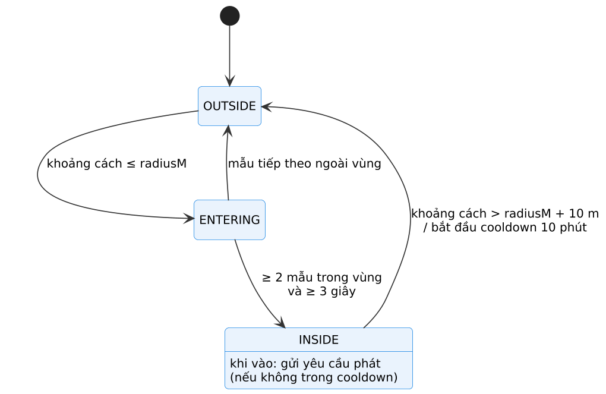

| Chuyển trạng thái | Điều kiện | Hành động |
|----------------------|-------------------------------------|-----------------------------------------------|
| OUTSIDE → ENTERING | Khoảng cách ≤ radiusM | Ghi thời điểm bắt đầu |
| ENTERING → INSIDE | ≥ 2 mẫu hợp lệ trong vùng **và** ≥ 3 giây | Gửi yêu cầu phát (trigger `gps`) vào bộ điều phối |
| ENTERING → OUTSIDE | Mẫu tiếp theo ngoài vùng | Hủy |
| INSIDE → OUTSIDE | Khoảng cách > radiusM + 10 m | Ghi thời điểm rời vùng |
| Thời gian chờ | Đã tự phát điểm này trong 10 phút | Không tự phát lại; vẫn phát thủ công được |

### Xử lý xung đột

- Đứng trong **nhiều vùng**: chọn priority cao nhất; bằng nhau thì chọn điểm **gần nhất**.
- Đang phát bài khác: **không cắt ngang**; hiện thẻ "Bạn đang ở gần … – Nghe ngay". Bấm thì chuyển; không bấm thì xếp hàng và tự phát khi bài hiện tại hết (nếu còn trong vùng).
- Đã **nghe hết** điểm (≥ 90% thời lượng) trong ngày: chỉ hiện thẻ gợi ý.
- Khách **tắt tự động phát**: chỉ hiện thẻ gợi ý.
- Khách ở xa khuôn viên > 1 km: banner "Bạn đang ở xa Dinh Độc Lập", không tự phát.

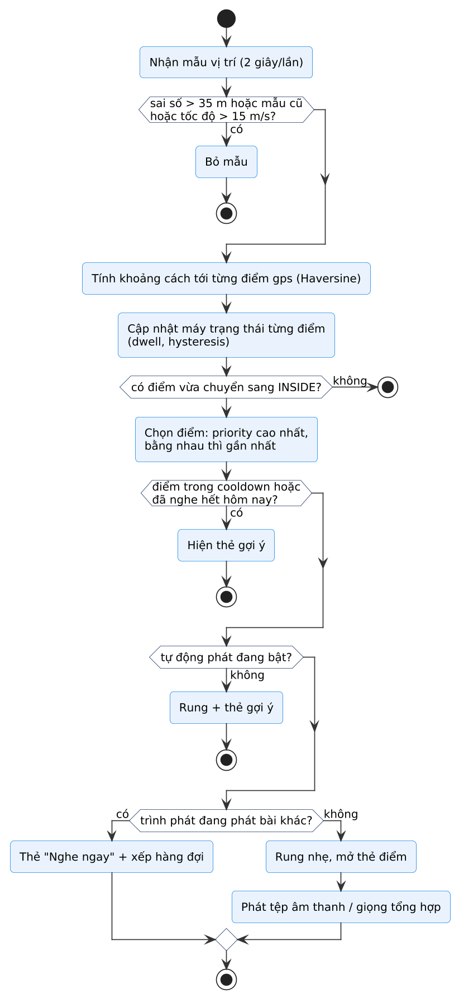

### Tiết kiệm pin

- Dừng theo dõi vị trí khi ứng dụng xuống nền; tiếp tục khi quay lại.
- Không gửi tọa độ lên máy chủ.
- Giai đoạn 2: giảm tần suất lấy mẫu khi ở xa mọi điểm > 300 m.

> **Cảnh báo:** Bán kính tối thiểu 15 m vì sai số GPS điện thoại ngoài trời thường 5–20 m. Web Admin cảnh báo khi hai vùng ngoài trời giao nhau quá nhiều (FE-20).

## Kích hoạt trong nhà bằng QR hoặc số điểm (FE-06)

GPS trong tòa nhà sai số 10–50 m và **không phân biệt tầng**, nên mỗi phòng có biển nhỏ in **mã QR + số điểm**.

- Nội dung QR là **liên kết web thường**: `https://<web-user>/p/201`. Camera điện thoại chưa cài ứng dụng → mở trang điểm trên Web User; trong ứng dụng → mở thẳng điểm 201 (deep link `dinhdoclap://p/201` cũng được chấp nhận).
- Trong ứng dụng có nút **Quét mã** (expo-camera) và **bàn phím số** 3 chữ số (dự phòng khi thiếu sáng hoặc từ chối quyền camera).
- Số không tồn tại → "Không tìm thấy điểm 209"; điểm bị ẩn → "Điểm này tạm ngừng thuyết minh"; QR lạ → "Mã không hợp lệ".
- Web Admin có trang **in mã QR** (FE-24).

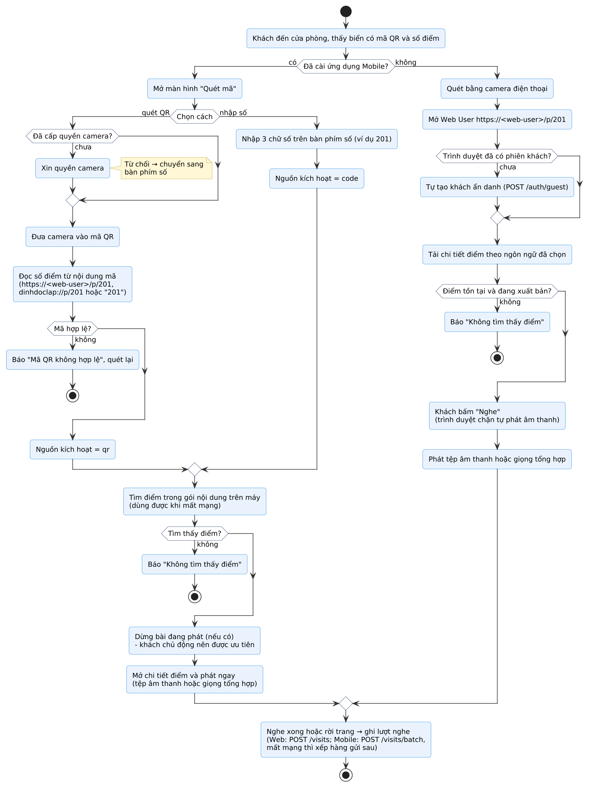

## Bộ điều phối phát và trình phát (FE-07)

Mọi yêu cầu phát (GPS, QR, số điểm, bấm tay, mô phỏng) đi qua **một** `NarrationController`.

| Nguồn yêu cầu | Ưu tiên | Khi đang phát bài khác |
|-----------------------------------------------|------------|---------------------------------------------|
| Bấm tay (Nghe ngay, chọn từ danh sách) – `manual` | Cao nhất | Dừng bài hiện tại, phát bài mới |
| QR / số điểm – `qr`, `code` | Cao | Dừng bài hiện tại, phát bài mới |
| GPS tự động – `gps`, `simulated` | Thấp | Không cắt ngang; hiện thẻ gợi ý, xếp hàng đợi |

### Nguồn âm thanh

1. Có tệp âm thanh đã tải về máy → phát tệp cục bộ (expo-audio).
2. Có tệp nhưng chưa tải, đang có mạng → phát trực tiếp từ URL (hỗ trợ tua nhờ HTTP Range).
3. Không có tệp → **giọng tổng hợp thiết bị** (expo-speech; Web Speech API trên web) với locale BCP 47 (ví dụ `ja-JP`).
4. Thiết bị không có giọng cho ngôn ngữ đó → hiện văn bản kèm thông báo.

Từ v2.0 cả 120 bài đều có **tệp giọng đọc AI** (mục 4.10), nên đường 3–4 chỉ còn là dự phòng.

### Điều khiển

- Phát / tạm dừng; phát lại từ đầu; tua ±10 giây (chỉ với tệp âm thanh); tốc độ 0,75× – 1× – 1,25× – 1,5×.
- Đổi ngôn ngữ ngay trong trình phát: bài phát lại từ đầu bằng ngôn ngữ mới.
- Trình phát thu nhỏ (mini player) luôn hiện trên thanh tab khi có bài đang phát.
- Văn bản bài thuyết minh hiển thị kèm (người khiếm thính, nơi ồn).
- Khi bài kết thúc hoặc bị dừng: ghi **lượt ghé** (`listenedSec`, `completed` khi ≥ 90%, `trigger`); gửi ngay nếu có mạng, nếu không thì xếp hàng gửi sau.

## Hoạt động offline (FE-08)

### Gói nội dung

`GET /api/v1/content/bundle?lang=en` trả toàn bộ điểm đã xuất bản và bài của ngôn ngữ đó, kèm `version` và danh sách tệp âm thanh. Header `ETag` = version; gọi lại với `If-None-Match` nhận 304 nếu không đổi. `GET /content/version` kiểm tra nhanh.

### Lưu trên máy

| Dữ liệu | Nơi lưu |
|-----------------------------------|--------------------------------------------|
| Gói nội dung JSON theo ngôn ngữ | `documentDirectory/bundles/{lang}.json` |
| Tệp âm thanh | `documentDirectory/audio/{lang}/{code}.mp3` |
| Ảnh điểm | Đóng gói sẵn trong ứng dụng (`assets/places/`) |
| Lượt ghé chưa gửi, tiến độ, cài đặt | AsyncStorage |
| Refresh token của khách | expo-secure-store |

### Cập nhật và đồng bộ

- Mở ứng dụng có mạng: kiểm tra version; có bản mới thì tải JSON ngay, hỏi trước khi tải lại âm thanh.
- Cài đặt → Dữ liệu ngoại tuyến: phiên bản, nút Cập nhật, Tải âm thanh, Xóa.
- Lượt ghé khi offline xếp hàng; có mạng thì gửi theo lô `POST /visits/batch`, mỗi bản ghi có `clientId` (UUID) để máy chủ bỏ trùng.

## Khách ẩn danh và người dùng đang hoạt động (FE-01, FE-19)

### Khách ẩn danh

- Lần đầu mở, client gọi `POST /auth/guest` → API tạo `users` với `is_guest = 1`, `role = 'user'`, email nội bộ `guest-<uuid>@guest.local`, `password_hash = NULL`, tên "Khách #XXXX"; trả access token + refresh token.
- Web User giữ refresh token trong cookie HttpOnly `rt_web` (theo từng tên miền); Mobile giữ trong expo-secure-store. Lần sau gọi `POST /auth/refresh` → đúng khách cũ.
- Hệ quả của cookie theo tên miền: cùng một trình duyệt mở `localhost`, `127.0.0.1`, IP Wi-Fi và link tunnel là **4 khách khác nhau** – dùng để mô phỏng nhiều khách khi trình diễn (`npm run demo`).

### Presence

- Mỗi ứng dụng mở **một** kết nối Socket.IO; máy chủ ghi một dòng `user_sessions`; client gửi `presence.ping` mỗi 30 giây.
- **Đang hoạt động** = phiên chưa đóng và nhịp tim trong 60 giây; đếm theo người (view `v_active_users`, GROUP BY user). Mất mạng đột ngột → tác vụ dọn phiên đóng phiên cũ.
- Web Admin nhận `presence.update` để cập nhật số và danh sách ngay lập tức.

## Chế độ mô phỏng vị trí (FE-11)

```ts
interface LocationProvider {
  kind: "real" | "simulated";
  start(onFix: (fix: Fix) => void, onError: (e: Error) => void): Promise<void>;
  stop(): void;
}
// RealLocationProvider      → expo-location watchPositionAsync
// SimulatedLocationProvider → teleport(p) khi chạm bản đồ, playRoute(waypoints, speedup)
```

- **Chạm trên bản đồ:** vị trí giả nhảy tới điểm chạm (sai số giả 8 m).
- **Lộ trình mẫu:** đi qua lần lượt 5 điểm ngoài trời với tốc độ đi bộ, có tăng tốc, thêm nhiễu ±3 m để thử cơ chế chống dao động.
- Bật trong Cài đặt → "Chế độ mô phỏng"; khi bật có nhãn **MÔ PHỎNG**; lượt ghé ghi `trigger = simulated` để không lẫn số liệu thật. Bản phát hành cho khách (APK production) ẩn công tắc này (mục 18).
- Toàn bộ logic 4.3–4.5 dùng chung cho vị trí thật và mô phỏng.

## Đa ngôn ngữ

| Lớp | Phạm vi | Cách làm |
|--------------------|--------------------------------------------------|--------------------------------------------------|
| **Ngôn ngữ thuyết minh** | 10 ngôn ngữ (Phụ lục B); Admin thêm được từ danh mục ISO 639-1 | Bảng `languages` + `place_contents` |
| **Ngôn ngữ giao diện** | Trùng với ngôn ngữ thuyết minh đã chọn (10 ngôn ngữ) | i18n tự viết (`mobile/src/i18n.ts`, `web/src/lib/i18n.ts`); thiếu chuỗi thì dùng tiếng Anh |

- Khách chỉ thấy ngôn ngữ **đang bật** và có ít nhất một bài đã xuất bản; tìm kiếm không phân biệt hoa thường và dấu, khớp tên Việt, tên bản ngữ, tên tiếng Anh, mã (gõ "nhat", "japanese", "日本", "ja" đều ra tiếng Nhật).
- Dự phòng khi một điểm thiếu bài: ngôn ngữ đã chọn → tiếng Anh → tiếng Việt, có ghi chú trên giao diện.
- Bài **chờ duyệt** vẫn hiện cho khách kèm nhãn "Bản dịch đang được kiểm duyệt"; bài **nháp** không hiện.
- Web Admin hiển thị bằng tiếng Việt.

## Giọng đọc AI

**Quyết định v2.0:** không thu âm giọng người; mọi bài có tệp âm thanh sinh bằng **giọng neural** (Microsoft Edge TTS qua thư viện mã nguồn mở `edge-tts`). Lý do: đủ 10 ngôn ngữ, chất lượng tự nhiên hơn giọng thiết bị, đồng nhất trên mọi điện thoại, phát được offline, tua được.

| Bước | Nội dung |
|----------------|--------------------------------------------------|
| 1. Duyệt văn bản | Biên tập viên duyệt bài 10 ngôn ngữ (đối chiếu nguồn, mục 15.4). |
| 2. Sinh tệp | `npm run gen:audio` (thư mục `api/`) đọc `db/seed/places.*.json`, gọi edge-tts với giọng ở Phụ lục B, ghi `db/seed/audio/<lang>/<code>.mp3` (24 kHz, 48 kbps mono). Chạy lại chỉ sinh tệp thiếu hoặc bài đã đổi (so sánh mã băm văn bản). |
| 3. Nạp | `npm run db:seed` chép tệp vào `storage/audio/` và cập nhật `audio_url`, `audio_duration_sec`, `audio_bytes`. |
| 4. Phát | Mobile/Web phát tệp như bản thu âm (mục 4.5.1). |

Các tệp MP3 được commit vào kho (khoảng 120 × 0,5 MB) để máy không có mạng vẫn seed được. Web Admin vẫn cho tải tệp khác thay thế (FE-21). Giới hạn sử dụng dịch vụ ghi ở mục 15.4.

# Tính năng Mobile (React Native)

Ứng dụng dùng expo-router (`mobile/src/app/`). Màn hình: `welcome`, `language`, `(tabs)/map`, `(tabs)/places`, `(tabs)/settings`, `place/[code]`, `p/[code]` (deep link QR), `player`, `scan`, và `history` (FE-10, cần làm). Thanh tab dưới: **Bản đồ · Điểm · Cài đặt**; mini player nằm trên thanh tab.

## FE-01. Khách ẩn danh

| | |
|----------------|------------------------------------------------------------------------------------|
| **Ưu tiên** | Phải · **Hiện trạng:** Đã có |
| **Màn hình** | `welcome` (lần đầu), sau đó `language` |
| **Luồng chính** | 1. Lần đầu mở: màn Chào mừng có một nút "Bắt đầu tham quan" – không đăng ký/đăng nhập. 2. Ứng dụng gọi `POST /auth/guest` → lưu refresh token trong expo-secure-store, access token trong bộ nhớ; mở Socket.IO (presence). 3. Lần sau mở: `POST /auth/refresh` khôi phục đúng khách cũ. 4. Access token hết hạn → tự làm mới **một lần** cho mọi request đang chờ (single-flight). |
| **Ngoại lệ** | Mất mạng lúc mở lần đầu → vẫn nghe nội dung đã tải; khách được tạo khi có mạng. Tài khoản bị khóa (`403 ACCOUNT_LOCKED` hoặc `session.revoked`) → thông báo "Tài khoản đã bị khóa", **không** tự tạo khách mới. |
| **Tiêu chí chấp nhận** | AC1. Nghe được thuyết minh mà không nhập gì. AC2. Mở lại ứng dụng vẫn đúng khách cũ. AC3. Web Admin thấy khách đang hoạt động trong ≤ 3 giây. |
| **Liên quan** | UC-01; SD-04; mục 4.7 |

## FE-02. Chọn ngôn ngữ thuyết minh

| | |
|----------------|------------------------------------------------------------------------------------|
| **Ưu tiên** | Phải · **Hiện trạng:** Đã có |
| **Màn hình** | `language` (sau Chào mừng; mở lại từ Cài đặt và trình phát) |
| **Luồng chính** | 1. `GET /languages` (offline: danh sách đã lưu). 2. Mỗi dòng: tên bản ngữ (日本語), tên tiếng Việt, mức hoàn thiện; ngôn ngữ của thiết bị đứng đầu. 3. Ô tìm kiếm lọc ngay khi gõ, không phân biệt hoa thường và dấu. 4. Chọn → tải gói nội dung, giao diện đổi sang ngôn ngữ đó. |
| **Ngoại lệ** | Không có kết quả → "Chưa có thuyết minh cho ngôn ngữ này" + gợi ý tiếng Anh. Offline và chưa tải → chỉ hiện ngôn ngữ đã tải. |
| **Tiêu chí chấp nhận** | AC1. Gõ "nhat", "japanese", "日本", "ja" đều ra tiếng Nhật. AC2. Chọn xong áp dụng ngay cho trình phát và giao diện. |
| **Liên quan** | UC-03; Phụ lục B |

## FE-03. Bản đồ khuôn viên

| | |
|----------------|------------------------------------------------------------------------------------|
| **Ưu tiên** | Phải · **Hiện trạng:** Đã có |
| **Màn hình** | Tab `map` |
| **Luồng chính** | 1. Xin quyền vị trí "Khi dùng ứng dụng" (giải thích trước). 2. Bản đồ căn giữa Dinh Độc Lập; chấm vị trí khách. 3. Marker từng điểm có số điểm, màu theo trạng thái (chưa nghe / đang phát / đã nghe); vòng mờ thể hiện vùng kích hoạt điểm gps. 4. Bấm marker → thẻ nhỏ (tên, khoảng cách, Nghe) → mở chi tiết. 5. Nút Quét mã; nhãn GPS yếu / MÔ PHỎNG. |
| **Ngoại lệ** | Từ chối quyền vị trí → bản đồ vẫn hiện điểm, banner "Bật vị trí để tự động thuyết minh", QR/số điểm vẫn dùng được. Ở xa > 1 km → banner "Bạn đang ở xa Dinh Độc Lập". |
| **Tiêu chí chấp nhận** | AC1. 12 điểm hiện đúng vị trí, vùng đúng bán kính. AC2. Từ chối quyền vị trí không làm ứng dụng lỗi. |
| **Liên quan** | UC-04 |

## FE-04. Danh sách và chi tiết điểm

| | |
|----------------|------------------------------------------------------------------------------------|
| **Ưu tiên** | Phải · **Hiện trạng:** Đã có |
| **Màn hình** | Tab `places`, `place/[code]` |
| **Luồng chính** | 1. Thẻ tiến độ (FE-09) ở đầu. 2. Danh sách nhóm theo khu vực: Ngoài trời, Tầng trệt, Lầu 1, Lầu 2–3, Sân thượng, Tầng hầm. 3. Mỗi dòng: số điểm, tiêu đề theo ngôn ngữ, khoảng cách (điểm gps), dấu ✓ đã nghe. 4. Ô tìm kiếm theo tên hoặc số. 5. Chi tiết: ảnh, số điểm, tiêu đề, tóm tắt, nút **Nghe thuyết minh**, văn bản đầy đủ, kiểu kích hoạt. |
| **Tiêu chí chấp nhận** | AC1. Tìm "201" hoặc "trình quốc thư" ra đúng điểm. AC2. Chi tiết đúng ngôn ngữ, có ghi chú khi dùng ngôn ngữ dự phòng. |
| **Liên quan** | UC-05 |

## FE-05. Tự động thuyết minh theo GPS

| | |
|----------------|------------------------------------------------------------------------------------|
| **Ưu tiên** | Phải – chức năng cốt lõi · **Hiện trạng:** Đã có; *cần làm: rung khi đến điểm* |
| **Mô tả** | Thuật toán mục 4.3: lọc tín hiệu, Haversine, máy trạng thái có dwell và hysteresis, cooldown, xử lý xung đột, không cắt ngang. |
| **Luồng chính** | 1. Khách vào vùng điểm gps → sau 3 giây ổn định: **rung nhẹ** (expo-haptics, nếu bật trong Cài đặt), thẻ điểm hiện lên, bài tự phát. 2. Đang phát bài khác → thẻ gợi ý "Nghe ngay". 3. Rời vùng khi đang phát → bài phát tiếp đến hết. |
| **Quy tắc** | Chỉ khi ứng dụng ở foreground. Bật/tắt trong Cài đặt (mặc định bật). Hằng số ở Phụ lục C. |
| **Tiêu chí chấp nhận** | AC1. Lộ trình mô phỏng có nhiễu ±3 m: 5 điểm ngoài trời phát đúng thứ tự, mỗi điểm 1 lần. AC2. Dao động ở mép vùng không phát lặp. AC3. Hai vùng giao nhau → phát điểm ưu tiên/gần hơn. AC4. Từ lúc vào vùng đến lúc phát ≤ 3 giây. |
| **Liên quan** | UC-06; SD-01; TC-10 → TC-15 |

## FE-06. Kích hoạt trong nhà: QR / số điểm

| | |
|----------------|------------------------------------------------------------------------------------|
| **Ưu tiên** | Phải · **Hiện trạng:** Đã có |
| **Màn hình** | `scan` (camera + bàn phím số); deep link `p/[code]` |
| **Luồng chính** | 1. Nút "Quét mã" trên tab Bản đồ. 2. Camera đọc QR → lấy số điểm (`core/qr.ts` chấp nhận `https://…/p/201`, `dinhdoclap://p/201`, `201`) → mở chi tiết và phát ngay. 3. Hoặc "Nhập số điểm" → 3 chữ số → Nghe. |
| **Ngoại lệ** | Từ chối quyền camera → bàn phím số. QR lạ → "Mã không hợp lệ". Số không tồn tại / điểm ẩn → thông báo tương ứng. |
| **Tiêu chí chấp nhận** | AC1. QR in từ FE-24 mở đúng điểm trong ≤ 1 giây (đã tải offline). AC2. Camera điện thoại chưa cài ứng dụng → mở trang Web User của điểm. |
| **Liên quan** | UC-07; SD-02; Hình 6 |

## FE-07. Trình phát thuyết minh

| | |
|----------------|------------------------------------------------------------------------------------|
| **Ưu tiên** | Phải · **Hiện trạng:** Đã có |
| **Giao diện** | Mini player trên thanh tab (tiêu đề, phát/tạm dừng). Màn `player`: tiêu đề, thanh tiến trình, thời gian, lùi 10 s / phát–tạm dừng / tới 10 s (tệp âm thanh), phát lại, tốc độ, nút ngôn ngữ, dừng, văn bản cuộn; nhãn "Giọng tổng hợp" khi phát bằng TTS thiết bị. |
| **Quy tắc** | Âm thanh tiếp tục khi khóa màn hình nhưng không tự kích hoạt điểm mới khi ở nền. Ghi lượt ghé khi kết thúc/dừng (mục 4.5). |
| **Tiêu chí chấp nhận** | AC1. Đủ nút điều khiển với tệp âm thanh; TTS hỗ trợ phát/dừng/phát lại. AC2. Đổi ngôn ngữ giữa chừng phát lại từ đầu bằng ngôn ngữ mới. AC3. Không bao giờ có hai bài phát cùng lúc. |
| **Liên quan** | UC-08 |

## FE-08. Tải trước nội dung (offline)

| | |
|----------------|------------------------------------------------------------------------------------|
| **Ưu tiên** | Phải · **Hiện trạng:** Đã có |
| **Luồng chính** | 1. Chọn ngôn ngữ → tải gói JSON. 2. Cài đặt → Dữ liệu ngoại tuyến: phiên bản, **Cập nhật**, **Tải âm thanh** (kèm tiến trình), **Xóa**. 3. Lượt ghé chưa gửi hiện số lượng; tự gửi khi có mạng. |
| **Tiêu chí chấp nhận** | AC1. Chế độ máy bay sau khi tải: FE-03 → FE-07 hoạt động đủ, phát tệp giọng AI. AC2. Admin xuất bản bản mới → ứng dụng có mạng nhận khi mở lại. AC3. Lượt ghé offline gửi đủ, không trùng. |
| **Liên quan** | UC-09; SD-03 |

## FE-09. Tiến độ và điểm gợi ý

| | |
|----------------|------------------------------------------------------------------------------------|
| **Ưu tiên** | Nên · **Hiện trạng:** Đã có; *cần làm: màn chúc mừng* |
| **Luồng chính** | 1. Thẻ trên tab Điểm: "Đã nghe 5/12 điểm" + thanh tiến độ. 2. "Điểm tiếp theo": điểm chưa nghe có sortOrder nhỏ nhất, kèm khoảng cách và mũi tên hướng (điểm gps). 3. Nghe đủ 12/12 → hộp thoại chúc mừng, nút xem Lịch sử. |
| **Tiêu chí chấp nhận** | AC1. Tiến độ cập nhật ngay khi nghe xong một điểm, kể cả offline. |
| **Liên quan** | UC-11 |

## FE-10. Lịch sử tham quan (Mobile)

| | |
|----------------|------------------------------------------------------------------------------------|
| **Ưu tiên** | Nên · **Hiện trạng:** *Cần làm* |
| **Màn hình** | `history` – mở từ Cài đặt và từ thẻ tiến độ |
| **Luồng chính** | 1. Có mạng: `GET /me/visits`; gộp với lượt ghé chưa gửi trên máy. 2. Danh sách theo ngày (giờ Việt Nam): giờ, số điểm + tiêu đề, cách kích hoạt (GPS / QR / Số điểm / Chọn tay / Mô phỏng), thời lượng đã nghe, dấu "đã nghe hết". 3. Bấm dòng → chi tiết điểm. |
| **Ngoại lệ** | Offline → chỉ hiện lượt ghé trên máy, ghi chú "Đang ngoại tuyến". Chưa có lượt nào → "Bạn chưa nghe điểm nào". |
| **Tiêu chí chấp nhận** | AC1. Nghe một điểm → xuất hiện đầu danh sách ngay. AC2. Cùng nội dung với `GET /me/visits` khi có mạng. |
| **Liên quan** | UC-19 |

## FE-11. Chế độ mô phỏng vị trí

| | |
|----------------|------------------------------------------------------------------------------------|
| **Ưu tiên** | Phải (kiểm thử, trình diễn) · **Hiện trạng:** Đã có; *cần làm: ẩn ở bản production* |
| **Luồng chính** | 1. Bật trong Cài đặt → nhãn MÔ PHỎNG. 2. Chạm trên bản đồ để đặt vị trí. 3. Nút chạy lộ trình mẫu: chấm vị trí đi qua lần lượt 5 điểm ngoài trời. |
| **Quy tắc** | *Cần làm:* bản build production cho khách (`EXPO_PUBLIC_DEMO=0`) ẩn công tắc và ô Máy chủ API; bản trình diễn (`EXPO_PUBLIC_DEMO=1`) hiện đủ. |
| **Tiêu chí chấp nhận** | AC1. Lộ trình mẫu kích hoạt đủ 5 điểm theo thứ tự, mỗi điểm một lần. AC2. Lượt ghé ghi `simulated`, không tính vào "Lượt tham quan hôm nay". |
| **Liên quan** | UC-20 |

## FE-12. Cài đặt

| | |
|----------------|------------------------------------------------------------------------------------|
| **Ưu tiên** | Phải · **Hiện trạng:** Đã có; *cần làm: rung, cỡ chữ* |
| **Nội dung** | Ngôn ngữ thuyết minh (= ngôn ngữ giao diện) · Tự động phát khi đến gần · **Rung khi đến điểm** · **Cỡ chữ văn bản** (Nhỏ / Vừa / Lớn, áp dụng cho chi tiết điểm và trình phát) · Chế độ mô phỏng · Dữ liệu ngoại tuyến (FE-08) · Lượt ghé chờ gửi · Lịch sử tham quan (FE-10) · Máy chủ API (bản trình diễn) · Phiên bản ứng dụng. |
| **Tiêu chí chấp nhận** | AC1. Mọi thiết lập được lưu và giữ sau khi mở lại ứng dụng. |

# Tính năng Web User (React)

Web User dùng cùng API, cùng bảng màu và logo với Mobile; bố cục đáp ứng từ 360 px. Mở lần đầu tự tạo khách ẩn danh (như FE-01, refresh token trong cookie `rt_web`); lỗi giao diện được chặn bởi `ErrorBoundary` để không bao giờ trắng trang.

| Route | Trang |
|-----------------------------------------|--------------------------------------------------|
| `/` | Trang chủ: giới thiệu, chọn ngôn ngữ, danh sách điểm |
| `/places?zone=&q=` | Danh sách điểm, tìm kiếm, lọc |
| `/p/:code` | Chi tiết điểm – đích của mã QR |
| `/map` | Bản đồ khuôn viên |
| `/me` | Lịch sử tham quan của khách |

## FE-13. Trang chủ và danh sách điểm

| | |
|----------------|------------------------------------------------------------------------------------|
| **Ưu tiên** | Phải · **Hiện trạng:** Đã có |
| **Luồng chính** | 1. Ảnh Dinh Độc Lập, câu giới thiệu, chọn ngôn ngữ. 2. Lưới thẻ điểm (ảnh, số, tiêu đề) theo khu vực; tìm theo tên/số; lọc khu vực. 3. Liên kết tải ứng dụng để tự động thuyết minh. |
| **Tiêu chí chấp nhận** | AC1. Tìm kiếm và lọc kết hợp đúng; URL giữ tham số để chia sẻ. |

## FE-14. Chi tiết điểm và nghe thuyết minh

| | |
|----------------|------------------------------------------------------------------------------------|
| **Ưu tiên** | Phải · **Hiện trạng:** Đã có |
| **Luồng chính** | 1. Ảnh, số điểm, tiêu đề, tóm tắt, văn bản theo ngôn ngữ. 2. Trình phát: thẻ `<audio>` khi có tệp (giọng AI); không có thì Web Speech API. 3. Đổi ngôn ngữ ngay trên trang (đang phát thì dừng và phát lại bằng ngôn ngữ mới). 4. Ghi lượt ghé `POST /visits` (clientId sinh bằng `uuidV4()` – có phương án dự phòng khi trình duyệt ở `http://IP` không có `crypto.randomUUID`). |
| **Ngoại lệ** | Trình duyệt không có giọng cho ngôn ngữ → chỉ hiện văn bản kèm thông báo. Gửi lượt ghé lỗi → bỏ qua, không ảnh hưởng nghe. |
| **Tiêu chí chấp nhận** | AC1. Mở `/p/201` từ QR trên điện thoại chưa cài ứng dụng → nghe được trong ≤ 3 giây. AC2. Đổi ngôn ngữ khi đang phát không trắng trang. |
| **Liên quan** | UC-05, UC-07 |

## FE-15. Bản đồ khuôn viên (web)

| | |
|----------------|------------------------------------------------------------------------------------|
| **Ưu tiên** | Nên · **Hiện trạng:** Đã có |
| **Mô tả** | Leaflet + OpenStreetMap (không cần khóa API): marker các điểm, vòng vùng kích hoạt, bấm marker mở chi tiết. |

## FE-16. Lịch sử tham quan (web)

| | |
|----------------|------------------------------------------------------------------------------------|
| **Ưu tiên** | Phải · **Hiện trạng:** Đã có |
| **Luồng chính** | Trang `/me`: tên khách ("Khách #XXXX"), danh sách điểm đã nghe và thời gian (`GET /me/visits`). |
| **Tiêu chí chấp nhận** | AC1. Khách mở Web User xuất hiện trong danh sách đang hoạt động của Web Admin. AC2. Nghe một điểm → có trong lịch sử. |
| **Liên quan** | UC-19 |

# Tính năng Web Admin (React)

Chỉ tài khoản `admin` đăng nhập được. Bố cục: thanh bên trái (Tổng quan, Đang hoạt động, Người dùng, Điểm thuyết minh, Ngôn ngữ, Nhật ký, In mã QR), thanh trên hiển thị trạng thái realtime và tài khoản.

| Route | Trang |
|----------------------------------|--------------------------------------------------|
| `/login` | Đăng nhập |
| `/` | Dashboard (FE-17) |
| `/active-users` | Đang hoạt động, Mời tham gia (FE-19, FE-23) |
| `/users` | Người dùng (FE-18) |
| `/places`, `/places/:id` | Điểm thuyết minh, sửa điểm và nội dung (FE-20, FE-21) |
| `/languages` | Ngôn ngữ (FE-22) |
| `/activity` | Nhật ký (FE-24) |
| `/print-qr` | In mã QR (FE-24) |

## FE-17. Dashboard

| | |
|----------------|------------------------------------------------------------------------------------|
| **Ưu tiên** | Phải · **Hiện trạng:** Đã có |
| **Nội dung** | 5 thẻ: Khách đã dùng · Đang hoạt động (realtime) · Lượt tham quan hôm nay · Điểm đang xuất bản · Bài chờ duyệt. Biểu đồ cột lượt tham quan 7 ngày (giờ Việt Nam); top 5 điểm nghe nhiều nhất 30 ngày; tỷ lệ ngôn ngữ; 10 hoạt động gần nhất. |
| **Quy tắc** | Số liệu từ `EXEC dbo.sp_admin_dashboard_stats`; không tính lượt `simulated` và tài khoản admin. Tự làm mới 60 giây; thẻ Đang hoạt động cập nhật theo `presence.update`. |
| **Tiêu chí chấp nhận** | AC1. Số trên thẻ khớp truy vấn SQL trực tiếp. AC2. Một khách mở Mobile/Web User → thẻ Đang hoạt động tăng trong ≤ 3 giây. |
| **Liên quan** | UC-12 |

## FE-18. Quản lý người dùng

| | |
|----------------|------------------------------------------------------------------------------------|
| **Ưu tiên** | Phải · **Hiện trạng:** Đã có |
| **Danh sách** | Cột: mã, tên hiển thị, loại (Khách / Quản trị viên), **online/offline** (chấm màu, realtime), **hoạt động gần nhất** ("5 phút trước"), trạng thái tài khoản, ngày tạo. Tìm theo tên/email; lọc loại, online, bị khóa; phân trang 20 dòng. |
| **Chi tiết** | Thông tin, số lượt ghé, **lịch sử phiên** (thiết bị web/mobile/admin, giờ vào, giờ ra, thời lượng), lượt ghé gần đây. |
| **Thao tác** | Khóa / mở khóa (bắt buộc nhập lý do) → thu hồi mọi refresh token, gửi `session.revoked` → thiết bị bị đăng xuất ngay. Đổi vai trò user ↔ admin (chỉ áp dụng cho tài khoản không phải khách). Không được tự khóa hoặc tự hạ quyền chính mình. |
| **Tiêu chí chấp nhận** | AC1. Khóa khách đang trực tuyến → ứng dụng của họ báo bị khóa trong ≤ 3 giây và không tự tạo khách mới. AC2. Thao tác khóa/mở được ghi nhật ký. |
| **Liên quan** | UC-13; SD-05 |

## FE-19. Người dùng đang hoạt động

| | |
|----------------|------------------------------------------------------------------------------------|
| **Ưu tiên** | Phải · **Hiện trạng:** Đã có |
| **Nội dung** | Số lớn "Đang hoạt động: N" và bảng: tên, loại thiết bị (Web/Mobile/Admin), số phiên, trực tuyến từ, hoạt động cuối. Lọc chỉ khách / tất cả. Nút **Mời tham gia (QR)** (FE-23). |
| **Tiêu chí chấp nhận** | AC1. Một người mở nhiều thiết bị chỉ tính 1, cột số phiên tăng. AC2. Mất mạng đột ngột → rời danh sách trong ≤ 90 giây. |
| **Liên quan** | UC-14; mục 4.7 |

## FE-20. Quản lý điểm thuyết minh

| | |
|----------------|------------------------------------------------------------------------------------|
| **Ưu tiên** | Phải · **Hiện trạng:** Đã có |
| **Danh sách** | Bảng: số điểm, ảnh, tên, khu vực, kiểu kích hoạt, số ngôn ngữ có bài, trạng thái, thứ tự; bản đồ bên cạnh hiện mọi điểm. |
| **Thêm / sửa** | Tên nội bộ, số điểm (3 chữ số, duy nhất), khu vực, kiểu kích hoạt, ưu tiên, thứ tự, ảnh (JPG/PNG/WebP ≤ 5 MB). Chọn tọa độ bằng nhấp trên bản đồ Leaflet hoặc nhập vĩ độ/kinh độ; bán kính 15–80 m; bản đồ tự căn về điểm đang sửa. Cảnh báo khi vùng giao với điểm khác. Chưa tải ảnh thì dùng ảnh có sẵn theo số điểm (`web/public/images/places`). |
| **Thao tác** | Xuất bản / ẩn / xóa (xóa chỉ khi chưa có lượt ghé, nếu có thì chỉ được ẩn). Mọi thay đổi xuất bản làm tăng phiên bản nội dung. |
| **Tiêu chí chấp nhận** | AC1. Thêm điểm mới kèm bài tiếng Việt ≤ 5 phút. AC2. Sửa tọa độ → Mobile sau khi cập nhật gói kích hoạt theo tọa độ mới. |
| **Liên quan** | UC-15; SD-03 |

## FE-21. Nội dung đa ngôn ngữ và âm thanh

| | |
|----------------|------------------------------------------------------------------------------------|
| **Ưu tiên** | Phải · **Hiện trạng:** Đã có |
| **Giao diện** | Trong trang sửa điểm: thẻ theo ngôn ngữ, mỗi thẻ có chấm trạng thái (chưa có / nháp / chờ duyệt / đã duyệt). Trường: tiêu đề (≤ 120 ký tự), tóm tắt (≤ 300), bài (≤ 5000), tệp âm thanh (MP3/M4A ≤ 20 MB), nguồn (người viết / máy dịch). Nút **Nghe thử** bằng giọng trình duyệt; nghe tệp đã tải; ước tính thời lượng đọc. |
| **Quy trình** | Nháp → Chờ duyệt → Đã duyệt. Bài chờ duyệt hiện cho khách kèm nhãn; bài nháp không hiện. |
| **Tiêu chí chấp nhận** | AC1. Tải tệp âm thanh → ứng dụng phát tệp thay giọng tổng hợp, tua được. AC2. Duyệt bản dịch → nhãn "đang kiểm duyệt" biến mất trên Mobile sau khi cập nhật gói. |
| **Liên quan** | UC-16 |

## FE-22. Quản lý ngôn ngữ

| | |
|----------------|------------------------------------------------------------------------------------|
| **Ưu tiên** | Phải · **Hiện trạng:** Đã có |
| **Nội dung** | Bảng: mã, tên tiếng Việt, tên bản ngữ, locale giọng đọc (BCP 47), bật/tắt, mức hoàn thiện (đã duyệt / chờ duyệt / thiếu). "Thêm ngôn ngữ": hộp chọn có tìm kiếm trên danh mục ISO 639-1. Tắt ngôn ngữ → khách không thấy nhưng dữ liệu được giữ. |
| **Tiêu chí chấp nhận** | AC1. Thêm tiếng Ý, viết bài cho 1 điểm, duyệt → khách tìm "Italiano" thấy tiếng Ý. |
| **Liên quan** | UC-17 |

## FE-23. Mời khách tham gia bằng QR

| | |
|----------------|------------------------------------------------------------------------------------|
| **Ưu tiên** | Phải · **Hiện trạng:** Đã có; *cần làm: sửa dòng hướng dẫn theo loại địa chỉ* |
| **Màn hình** | Hộp thoại "Mời tham gia" trên trang Đang hoạt động |
| **Luồng chính** | 1. `GET /admin/join-link` trả các địa chỉ Web User có thể dùng, theo thứ tự ưu tiên: **địa chỉ công khai** (`WEB_USER_PUBLIC_URL`) → **Cloudflare Tunnel** (khách dùng 4G vẫn vào) → **IP Wi-Fi** của máy chủ. 2. Hiện mã QR lớn + địa chỉ dạng chữ + nút sao chép; chọn được địa chỉ khác. 3. Dòng hướng dẫn đổi theo loại: công khai/tunnel – "Quét bằng camera, dùng 4G hoặc Wi-Fi đều được"; IP Wi-Fi – "Điện thoại phải dùng cùng Wi-Fi với máy chủ". |
| **Tiêu chí chấp nhận** | AC1. Bốn điện thoại quét QR → bảng Đang hoạt động hiện 4 khách trong ≤ 3 giây. AC2. Không có tunnel → tự dùng IP Wi-Fi, hướng dẫn đúng loại. |
| **Liên quan** | UC-10; mục 4.7 |

## FE-24. Nhật ký hoạt động và in mã QR

| | |
|----------------|------------------------------------------------------------------------------------|
| **Ưu tiên** | Phải · **Hiện trạng:** Đã có |
| **Nhật ký** | Ghi: đăng nhập admin (thành công/thất bại), đăng xuất, tạo khách, thêm/sửa/xuất bản/xóa điểm và bài, tải tệp, khóa/mở người dùng, thêm/bật/tắt ngôn ngữ. Lọc theo người, hành động, thời gian. |
| **In mã QR** | Trang `/print-qr`: lưới A4, mỗi ô có QR (`https://<web-user>/p/{code}`), số điểm cỡ lớn, tên tiếng Việt và tiếng Anh, dòng "Quét để nghe thuyết minh"; chọn điểm cần in (mặc định điểm indoor); in bằng trình duyệt. |
| **Tiêu chí chấp nhận** | AC1. QR in ra quét được bằng camera điện thoại thông thường. |
| **Liên quan** | UC-18 |

# Use case

## Sơ đồ use case

Ba tác nhân: **Khách** (user, is_guest), **Quản trị viên** (admin), **Người kiểm thử** (thành viên nhóm hoặc giảng viên dùng chế độ mô phỏng). Tác nhân phụ: **Dịch vụ định vị** của thiết bị (UC-06).

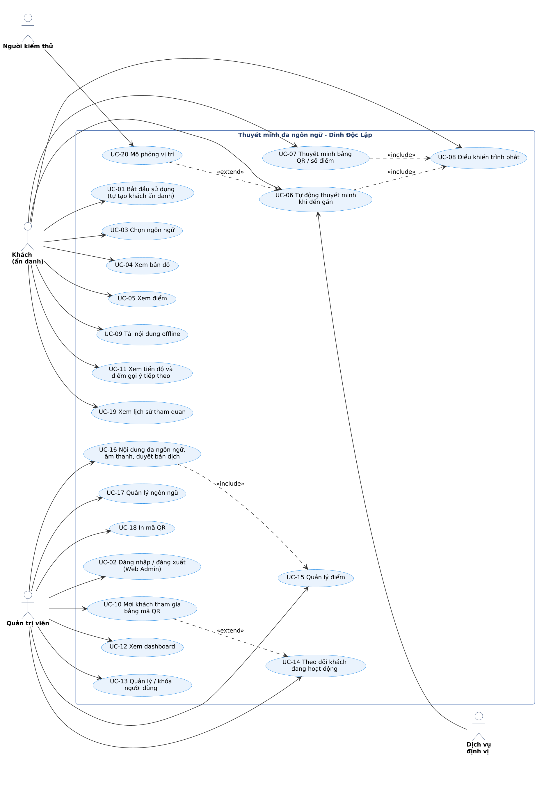

## Danh sách use case

| Mã | Tên | Tác nhân chính | Tính năng |
|---------------|-------------------------------------------|-------------------------|-------------------|
| UC-01 | Bắt đầu sử dụng (tự tạo khách ẩn danh) | Khách | FE-01, FE-13 |
| UC-02 | Đăng nhập / đăng xuất Web Admin | Quản trị viên | FE-17 |
| UC-03 | Chọn ngôn ngữ thuyết minh | Khách | FE-02 |
| UC-04 | Xem bản đồ khuôn viên | Khách | FE-03, FE-15 |
| UC-05 | Xem danh sách và chi tiết điểm | Khách | FE-04, FE-13, FE-14 |
| UC-06 | Nghe thuyết minh tự động khi đến gần | Khách (+ Dịch vụ định vị) | FE-05 |
| UC-07 | Nghe thuyết minh bằng QR / số điểm | Khách | FE-06, FE-14 |
| UC-08 | Điều khiển trình phát | Khách | FE-07 |
| UC-09 | Tải nội dung để dùng offline | Khách | FE-08 |
| UC-10 | Mời khách tham gia bằng mã QR | Quản trị viên | FE-23 |
| UC-11 | Xem tiến độ và điểm gợi ý tiếp theo | Khách | FE-09 |
| UC-12 | Xem dashboard | Quản trị viên | FE-17 |
| UC-13 | Quản lý người dùng, khóa tài khoản | Quản trị viên | FE-18 |
| UC-14 | Theo dõi khách đang hoạt động | Quản trị viên | FE-19 |
| UC-15 | Quản lý điểm thuyết minh | Quản trị viên | FE-20 |
| UC-16 | Soạn nội dung, tải âm thanh, duyệt bản dịch | Quản trị viên | FE-21 |
| UC-17 | Quản lý ngôn ngữ | Quản trị viên | FE-22 |
| UC-18 | In mã QR các phòng | Quản trị viên | FE-24 |
| UC-19 | Xem lịch sử tham quan | Khách | FE-10, FE-16 |
| UC-20 | Mô phỏng vị trí | Người kiểm thử | FE-11 |

Quan hệ: UC-06, UC-07 «include» UC-08 (mọi cách kích hoạt đều phát qua trình phát); UC-20 «extend» UC-06 (vị trí mô phỏng thay GPS thật); UC-16 «include» UC-15 (soạn nội dung trong trang sửa điểm); UC-10 «extend» UC-14 (nút Mời tham gia nằm trên trang Đang hoạt động). Các use case của Quản trị viên đều yêu cầu đã đăng nhập (UC-02).

## Đặc tả use case cốt lõi

### UC-01. Bắt đầu sử dụng (tự tạo khách ẩn danh)

| | |
|----------------|------------------------------------------------------------------------------------|
| **Tác nhân** | Khách |
| **Mục tiêu** | Dùng ngay mà không đăng ký, nhưng hệ thống vẫn nhận diện được khách. |
| **Tiền điều kiện** | Có mạng ở lần mở đầu tiên. |
| **Luồng chính** | 1. Khách mở Web User (hoặc Mobile, bấm "Bắt đầu tham quan"). 2. Client không có refresh token → gọi `POST /auth/guest`. 3. API tạo `users` (is_guest = 1, tên "Khách #XXXX"), refresh token, ghi nhật ký `auth.guest`; trả access token. 4. Client mở Socket.IO → `user_sessions` thêm một dòng → Web Admin nhận `presence.update`. 5. Khách chọn ngôn ngữ (UC-03). |
| **Luồng thay thế** | 2a. Đã có refresh token → `POST /auth/refresh` → đúng khách cũ (không tạo mới). 2b. Refresh token hỏng/hết hạn → tạo khách mới. 3a. Tài khoản bị khóa → thông báo, dừng. *a. Mất mạng → Mobile vẫn nghe nội dung đã tải; thử lại khi có mạng. |
| **Hậu điều kiện** | Khách có phiên hợp lệ; Web Admin đếm thêm 1 người đang hoạt động. |
| **Liên quan** | FE-01; SD-04 |

### UC-06. Nghe thuyết minh tự động khi đến gần

| | |
|----------------|------------------------------------------------------------------------------------|
| **Tác nhân** | Khách; tác nhân phụ: Dịch vụ định vị |
| **Mục tiêu** | Nghe đúng bài của điểm ngoài trời khi bước vào khu vực, không cần thao tác. |
| **Tiền điều kiện** | Đã chọn ngôn ngữ; có gói nội dung; đã cấp quyền vị trí; tự động phát đang bật; ứng dụng ở foreground. |
| **Luồng chính** | 1. Hệ thống nhận mẫu vị trí mỗi 2 giây và lọc mẫu kém. 2. Khách đi vào vùng điểm P. 3. Hệ thống xác nhận ở trong vùng ≥ 3 giây (≥ 2 mẫu). 4. Trình phát rảnh và P không trong thời gian chờ → rung, hiện thẻ P, phát bài của P. 5. Bài kết thúc → ghi lượt ghé (gps, completed) và cập nhật tiến độ. |
| **Luồng thay thế** | 3a. Ra khỏi vùng trước 3 giây → không phát. 4a. Đang phát bài khác → thẻ gợi ý "Nghe ngay"; bấm → chuyển; không bấm → xếp hàng. 4b. P đã phát trong 10 phút hoặc đã nghe hết hôm nay → chỉ gợi ý. 4c. Không có tệp → giọng tổng hợp; không có giọng → văn bản. *a. GPS sai số > 35 m kéo dài → "GPS yếu", gợi ý dùng QR. |
| **Hậu điều kiện** | Lượt ghé được lưu (gửi ngay hoặc xếp hàng); điểm ở trạng thái đã nghe. |
| **Liên quan** | FE-05, FE-07; SD-01; Hình 4, 5 |

### UC-07. Nghe thuyết minh bằng QR / số điểm

| | |
|----------------|------------------------------------------------------------------------------------|
| **Tác nhân** | Khách |
| **Mục tiêu** | Nghe bài của phòng đang đứng trong tòa nhà. |
| **Tiền điều kiện** | Biển QR + số điểm đặt tại phòng. |
| **Luồng chính** | 1. Khách bấm "Quét mã". 2. Camera đọc `https://<web-user>/p/201`. 3. Hệ thống tìm điểm 201 trong gói nội dung. 4. Mở chi tiết, phát ngay (dừng bài đang phát nếu có). 5. Ghi lượt ghé `qr`. |
| **Luồng thay thế** | 1a. Nhập số 201 trên bàn phím → bước 3 (trigger `code`). 2a. Không có quyền camera → bàn phím số. 3a. Không tìm thấy / điểm ẩn → thông báo. 1b. Quét bằng camera điện thoại khi chưa cài ứng dụng → mở Web User `/p/201`, tự tạo khách (UC-01), nghe trên trình duyệt. |
| **Hậu điều kiện** | Bài của phòng đang phát; lượt ghé được ghi. |
| **Liên quan** | FE-06, FE-14; SD-02; Hình 6 |

### UC-10. Mời khách tham gia bằng mã QR

| | |
|----------------|------------------------------------------------------------------------------------|
| **Tác nhân** | Quản trị viên |
| **Mục tiêu** | Cho nhiều khách vào Web User nhanh bằng một mã QR (trình diễn, sự kiện). |
| **Tiền điều kiện** | Đã đăng nhập Web Admin; Web User đang chạy. |
| **Luồng chính** | 1. Mở trang Đang hoạt động, bấm "Mời tham gia (QR)". 2. Hệ thống gọi `GET /admin/join-link`, chọn địa chỉ được khuyên dùng (công khai → tunnel → IP Wi-Fi). 3. Hiện QR, địa chỉ, dòng hướng dẫn theo loại địa chỉ. 4. Khách quét → UC-01. 5. Bảng Đang hoạt động thêm từng khách theo thời gian thực. |
| **Luồng thay thế** | 2a. Có nhiều IP → quản trị viên chọn địa chỉ khác trong danh sách. 4a. Khách dùng 4G với địa chỉ IP Wi-Fi → không vào được; hướng dẫn trên hộp thoại báo trước điều này. |
| **Hậu điều kiện** | Các khách mới xuất hiện trong danh sách đang hoạt động. |
| **Liên quan** | FE-23, FE-19 |

### UC-13. Quản lý người dùng, khóa tài khoản

| | |
|----------------|------------------------------------------------------------------------------------|
| **Tác nhân** | Quản trị viên |
| **Mục tiêu** | Ngăn tài khoản vi phạm tiếp tục sử dụng ngay lập tức. |
| **Tiền điều kiện** | Đăng nhập Web Admin. |
| **Luồng chính** | 1. Mở Người dùng, tìm theo tên. 2. Mở chi tiết, bấm "Khóa", nhập lý do, xác nhận. 3. Máy chủ đặt `status = locked`, thu hồi mọi refresh token, gửi `session.revoked` tới phòng `user:{id}`, ghi nhật ký `admin.user.lock`. 4. Thiết bị của người bị khóa đăng xuất và báo bị khóa. 5. Danh sách hiện "Bị khóa". |
| **Luồng thay thế** | 2a. Chọn chính mình → nút bị vô hiệu; API trả 403 nếu cố gọi. 4a. Thiết bị đang offline → bị chặn ở lần làm mới token tiếp theo (`403 ACCOUNT_LOCKED`). |
| **Hậu điều kiện** | Người dùng không làm mới phiên được; có bản ghi nhật ký. |
| **Liên quan** | FE-18; SD-05 |

### UC-16. Soạn nội dung, tải âm thanh, duyệt bản dịch

| | |
|----------------|------------------------------------------------------------------------------------|
| **Tác nhân** | Quản trị viên (biên tập viên) |
| **Mục tiêu** | Mỗi điểm có bài chính xác ở nhiều ngôn ngữ, có giọng đọc. |
| **Tiền điều kiện** | Điểm đã tồn tại (UC-15); ngôn ngữ đã bật (UC-17). |
| **Luồng chính** | 1. Mở điểm → thẻ ngôn ngữ. 2. Nhập tiêu đề, tóm tắt, bài; nghe thử. 3. (Tùy chọn) tải tệp MP3/M4A → máy chủ kiểm tra định dạng, dung lượng, đo thời lượng. 4. Chọn trạng thái Nháp / Chờ duyệt / Đã duyệt → Lưu. 5. Máy chủ tăng phiên bản nội dung; ứng dụng nhận bản mới. |
| **Luồng thay thế** | 3a. Sai định dạng hoặc > 20 MB → lỗi tại trường. 4a. Duyệt bản dịch: xem song song bản tiếng Việt, sửa rồi chuyển Đã duyệt. |
| **Hậu điều kiện** | Bài ở trạng thái mới; nhật ký `place.content.update`. |
| **Liên quan** | FE-21; SD-03 |

Các use case còn lại có luồng đơn giản, được mô tả đủ trong đặc tả tính năng tương ứng (cột Tính năng ở bảng 8.2).

# Sơ đồ tuần tự và trạng thái

## SD-01 – Tự động thuyết minh theo GPS

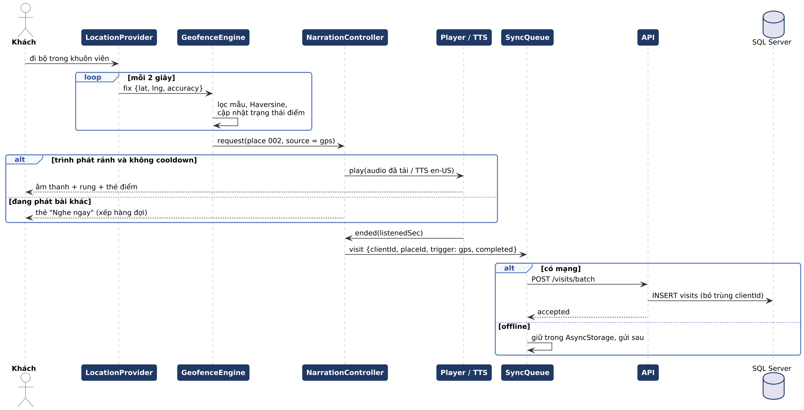

Mọi quyết định phát diễn ra trên thiết bị; máy chủ chỉ nhận lượt ghé (có thể trễ khi offline).

## SD-02 – Quét QR trong nhà

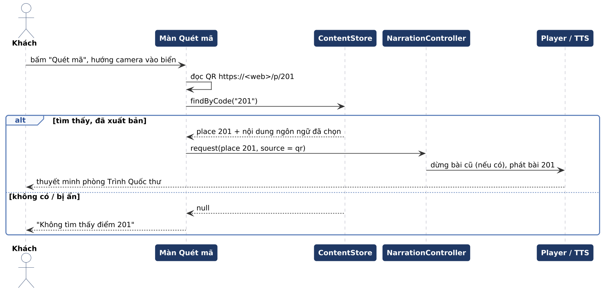

## SD-03 – Xuất bản nội dung và cập nhật trên ứng dụng

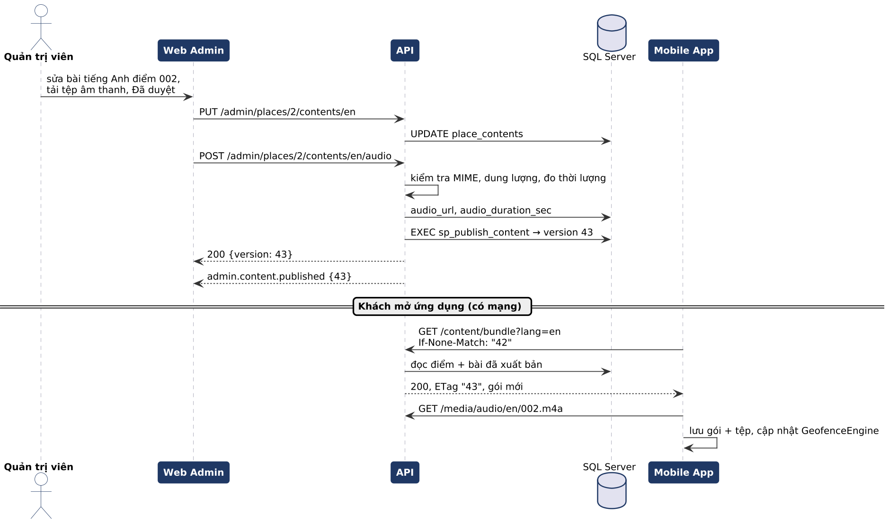

## SD-04 – Khách ẩn danh: bắt đầu và khôi phục phiên

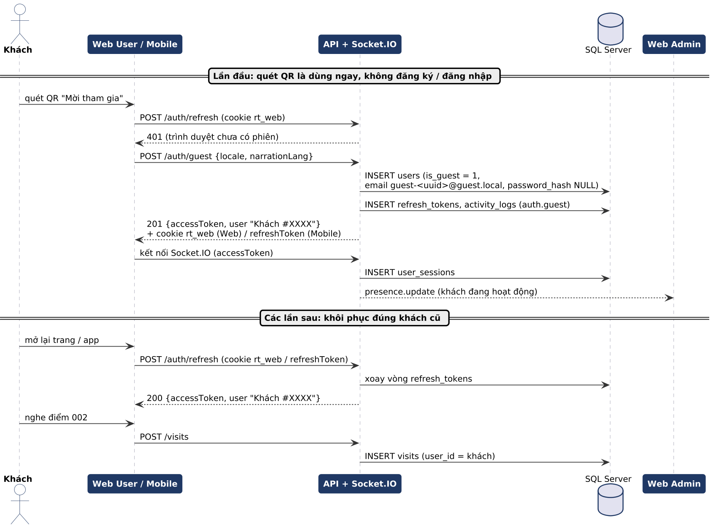

## SD-05 – Khóa tài khoản đang trực tuyến

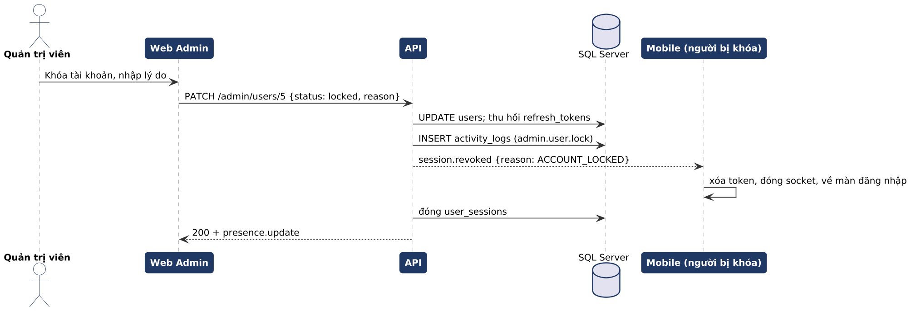

## Trạng thái bài thuyết minh

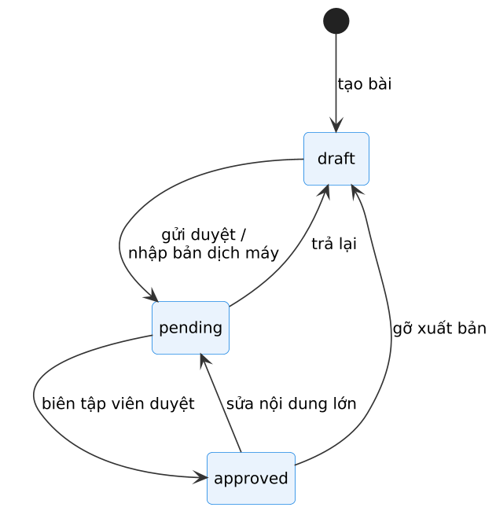

| Trạng thái | Hiển thị cho khách | Ai chuyển |
|----------------------|--------------------------------------------|--------------------------------------------------|
| **draft (nháp)** | Không | Quản trị viên tạo/sửa |
| **pending (chờ duyệt)** | Có, kèm nhãn "Bản dịch đang được kiểm duyệt" | Quản trị viên; bản dịch máy mặc định ở trạng thái này |
| **approved (đã duyệt)** | Có | Quản trị viên sau khi đối chiếu |

# Thiết kế giao diện

## Hệ thống thiết kế dùng chung

| Thành phần | Quy định |
|-------------------|--------------------------------------------------|
| **Màu chủ đạo** | Xanh rêu `#1f5c4a` (thanh trên, nút chính), xanh `#2c7a62` (trạng thái hoạt động, liên kết), vàng đồng `#c99a3e` (điểm nhấn, số điểm); nền sáng, thẻ trắng. Gợi màu tường đá và cây xanh của Dinh. |
| **Màu trạng thái** | Thành công/trực tuyến xanh lá; cảnh báo/GPS yếu/MÔ PHỎNG cam; lỗi đỏ; chưa nghe xám. Không truyền đạt trạng thái chỉ bằng màu. |
| **Logo** | Chữ "ĐĐL" trên nền xanh rêu; dùng cho biểu tượng ứng dụng, favicon, màn chào. |
| **Chữ** | Phông hệ thống; tiêu đề 22–28, nội dung 16, phụ 13–14; văn bản thuyết minh 17, chỉnh được (FE-12). |
| **Biểu tượng** | Bộ biểu tượng nét (lucide trên web, Ionicons trên Mobile); không dùng emoji trong giao diện chính. |
| **Bo góc, khoảng cách** | Bo 10–16 px; lưới 4 px; vùng chạm tối thiểu 44 × 44 px. |
| **Ảnh điểm** | Ảnh WebP/JPG trong `web/public/images/places` và `mobile/assets/places`, nguồn ghi ở `CREDITS.md`. |

## Màn hình Mobile

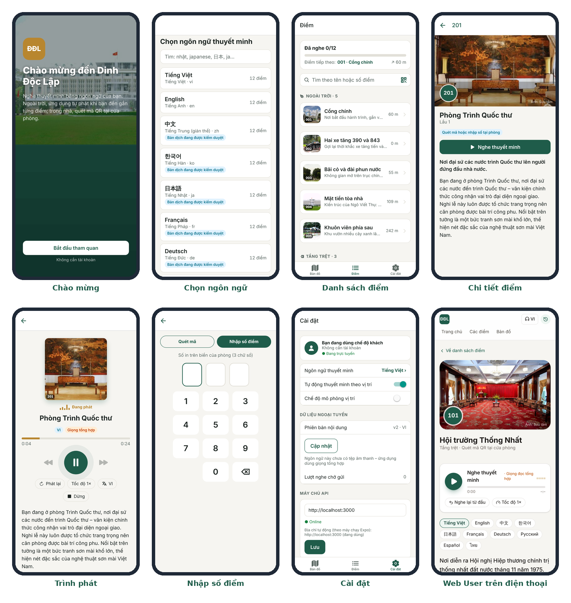

| Màn hình | Thành phần chính |
|----------------------|--------------------------------------------------|
| **Chào mừng** | Logo, ảnh Dinh, nút "Bắt đầu tham quan". |
| **Chọn ngôn ngữ** | Ô tìm kiếm; danh sách tên bản ngữ (lớn), tên tiếng Việt (nhỏ), mức hoàn thiện; dấu ✓ ngôn ngữ đang chọn. |
| **Bản đồ (tab 1)** | Bản đồ toàn màn hình; marker số điểm; vị trí khách; nút Quét mã; nhãn GPS yếu / MÔ PHỎNG; banner ở xa. |
| **Điểm (tab 2)** | Thẻ tiến độ và điểm tiếp theo; danh sách theo khu vực; ô tìm kiếm. |
| **Chi tiết điểm** | Ảnh, số điểm, tiêu đề, nút Nghe lớn, tóm tắt, văn bản. |
| **Trình phát** | Tiêu đề, thanh thời gian, lùi 10 s – Phát/Tạm dừng – tới 10 s, phát lại, tốc độ, ngôn ngữ, văn bản. |
| **Quét mã / Nhập số điểm** | Khung camera; chuyển sang bàn phím số 3 chữ số. |
| **Cài đặt (tab 3)** | Ngôn ngữ, tự động phát, rung, cỡ chữ, mô phỏng, dữ liệu ngoại tuyến, lịch sử, máy chủ API, phiên bản. |
| **Lịch sử** | Danh sách lượt ghé theo ngày (FE-10). |

## Web User

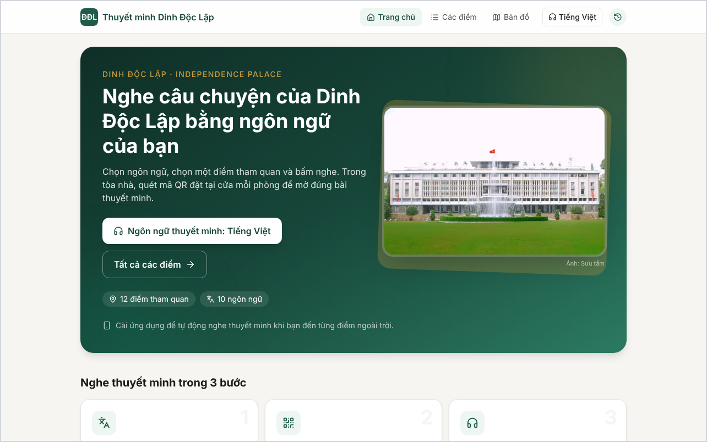

Thanh trên cùng: logo, liên kết các trang (Điểm, Bản đồ, Lịch sử), chọn ngôn ngữ. Trang chủ có phần giới thiệu và lưới thẻ điểm; chi tiết điểm hai cột trên máy tính (ảnh + trình phát | văn bản), một cột trên điện thoại (ảnh cuối Hình 14).

## Web Admin

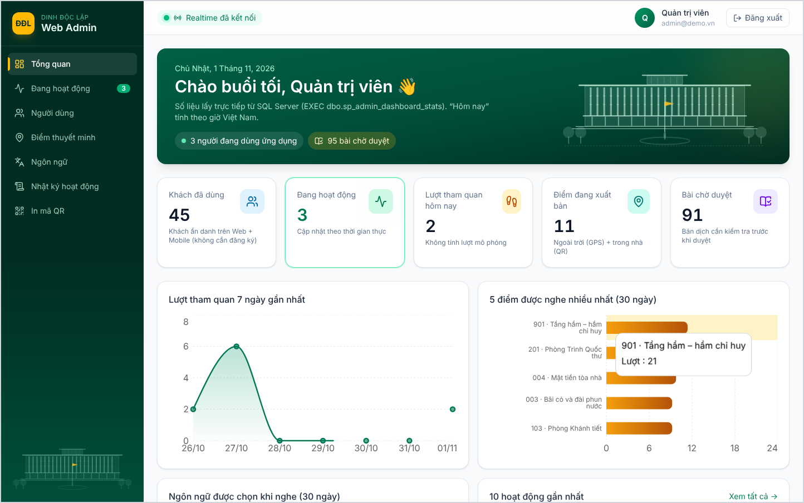

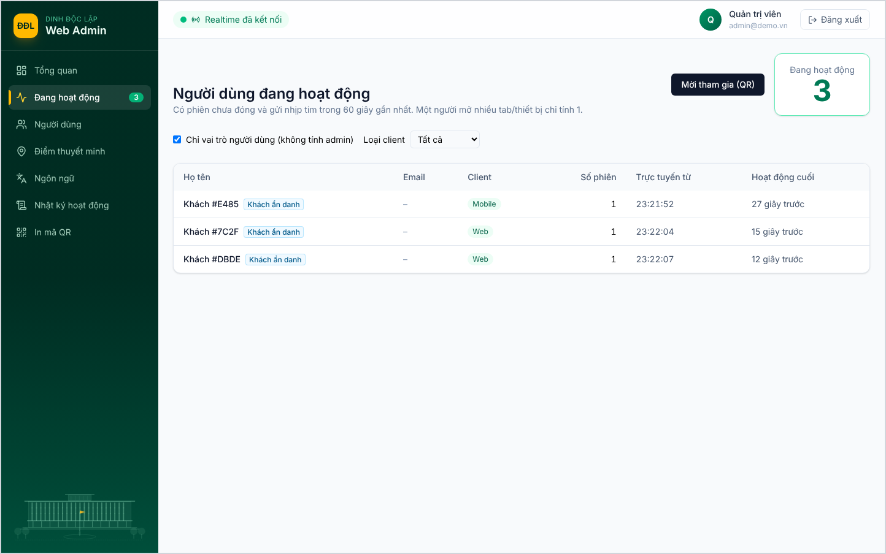

Thanh bên trái, thanh trên cùng hiển thị trạng thái realtime; bảng có tìm kiếm, lọc, phân trang; biểu mẫu sửa điểm chia hai cột: thông tin + bản đồ chọn tọa độ; nội dung theo thẻ ngôn ngữ.

## Khả năng tiếp cận

- Mọi bài thuyết minh có văn bản đi kèm (người khiếm thính, nơi ồn).
- Cỡ chữ văn bản chỉnh được; nhãn truy cập (`accessibilityLabel`, `aria-label`) cho mọi nút biểu tượng.
- Tương phản chữ/nền ≥ 4.5:1; trạng thái luôn kèm biểu tượng hoặc chữ.
- Rung nhẹ khi đến điểm để không cần nhìn màn hình.

# API

## Quy ước chung

| Mục | Quy ước |
|---------------|--------------------------------------------------|
| **Địa chỉ** | `/api/v1` (REST), `/socket.io` (realtime), `/media/...` (âm thanh, ảnh), `/api/docs` (Swagger UI), `/api/docs/openapi.json` |
| **Định dạng** | JSON UTF-8; thời gian ISO 8601 UTC; tham số `lang` theo ISO 639-1 |
| **Xác thực** | `Authorization: Bearer <accessToken>` (JWT 15 phút). Web User/Web Admin: refresh token trong cookie HttpOnly `rt_web` / `rt_admin` + header `X-CSRF-Token`; Mobile: refresh token trong body, lưu expo-secure-store. Refresh token sống 7 ngày, xoay vòng mỗi lần làm mới. |
| **Lỗi** | `{ error: { code, message, details?, requestId } }` |
| **Phân trang** | `?page=1&pageSize=20` → `{ items, page, pageSize, total }` |
| **Bộ đệm** | Gói nội dung trả `ETag`; client gửi `If-None-Match` → 304 |
| **Tệp** | `/media/audio/...` hỗ trợ HTTP Range (tua); `Cache-Control: public, max-age=86400` |
| **Tài liệu** | OpenAPI 3.1 sinh trang Swagger; test tự động kiểm tra tài liệu khớp route thật |

## Danh sách endpoint (sau khi dọn nhóm tham quan)

| Nhóm | Endpoint | Quyền | Mô tả |
|----------------------|--------------------------------------------------|---------------|--------------------------------------------------|
| Hệ thống | `GET /health` · `GET /health/ready` | – | Tình trạng API; kết nối CSDL và số migration |
| Xác thực | `POST /auth/guest` | – | Tạo khách ẩn danh → `{ accessToken, user }` + refresh token |
| | `POST /auth/login` | – | Đăng nhập **quản trị viên** (`clientType: admin`); 10 lần sai/15 phút/IP → 429 |
| | `POST /auth/refresh` · `POST /auth/logout` | – | Làm mới (xoay vòng) · thu hồi refresh token |
| Tài khoản | `GET /me` · `PATCH /me` | Đăng nhập | Hồ sơ; đổi tên hiển thị, ngôn ngữ thuyết minh mặc định |
| | `GET /me/visits` | Đăng nhập | Lịch sử tham quan (FE-10, FE-16) |
| Nội dung | `GET /languages` | – | Ngôn ngữ đang bật, có bài đã xuất bản, kèm mức hoàn thiện |
| | `GET /places?lang=&zone=&q=` | – | Danh sách điểm đã xuất bản kèm tiêu đề/tóm tắt (dự phòng en → vi) |
| | `GET /places/{code}?lang=` | – | Chi tiết theo số điểm (dùng cho QR): bài đầy đủ, URL âm thanh |
| | `GET /content/bundle?lang=` | – | Gói nội dung offline + version; ETag |
| | `GET /content/version` | – | Phiên bản nội dung hiện tại |
| Lượt ghé | `POST /visits` · `POST /visits/batch` | Đăng nhập | Ghi lượt ghé `{ clientId, placeId, lang, trigger, listenedSec, completed, startedAt }`; bỏ trùng theo clientId |
| Presence | `POST /presence/heartbeat` | Đăng nhập | Nhịp tim dự phòng khi mất Socket.IO |
| Quản trị | `GET /admin/stats` | admin | Số liệu Dashboard |
| | `GET /admin/presence` | admin | Khách đang hoạt động |
| | `GET /admin/join-link` | admin | Địa chỉ Web User cho mã QR mời tham gia |
| | `GET /admin/users` · `GET /admin/users/{id}` | admin | Danh sách (online, hoạt động gần nhất) · chi tiết + lịch sử phiên |
| | `PATCH /admin/users/{id}` | admin | `{ status: "locked" \| "active", reason }` khóa/mở · `{ role: "user" \| "admin" }` đổi vai trò |
| | `GET/POST /admin/places` · `GET/PATCH/DELETE /admin/places/{id}` | admin | Quản lý điểm (cả nháp, ẩn) |
| | `PUT /admin/places/{id}/contents/{lang}` · `DELETE …` | admin | Tạo/sửa/xóa bài một ngôn ngữ |
| | `POST /admin/places/{id}/contents/{lang}/audio` · `DELETE …/audio` | admin | Tải lên (multipart) / xóa tệp âm thanh |
| | `POST /admin/places/{id}/image` | admin | Tải ảnh điểm |
| | `GET /admin/languages` · `GET /admin/languages/catalog?q=` · `PUT /admin/languages/{code}` | admin | Ngôn ngữ đã thêm · danh mục ISO · thêm/bật/tắt |
| | `GET /admin/activity-logs` | admin | Nhật ký (lọc) |

**Bỏ ở v2.0 (cần làm, mục 18):** `POST /auth/register`; `GET /me/tour`; toàn bộ `/tours/*`, `GET /admin/tours`; trường `activeTours` của `/admin/stats`; giá trị `guide` trong kiểm tra vai trò.

## Ví dụ

**Gói nội dung**

```text
GET /api/v1/content/bundle?lang=en   → 200, ETag: "42"
{ "version": 42, "lang": "en", "ttsLocale": "en-US",
  "places": [{ "id": 2, "code": "002", "trigger": "gps", "zone": "outdoor",
     "lat": 10.7779, "lng": 106.6964, "radiusM": 25, "priority": 0, "sortOrder": 2,
     "imageUrl": null,
     "content": { "lang": "en", "title": "Tanks 390 and 843", "summary": "…", "body": "…",
        "status": "approved", "audioUrl": "/media/audio/en/002.mp3",
        "audioDurationSec": 41, "audioBytes": 246000 } }],
  "totalAudioBytes": 5900000 }
```

**Ghi lượt ghé theo lô (sau khi offline)**

```text
POST /api/v1/visits/batch
{ "visits": [ { "clientId": "7a1c…", "placeId": 2, "lang": "en", "trigger": "gps",
                "listenedSec": 41, "completed": true, "startedAt": "2026-11-10T03:12:05Z" } ] }
→ 200 { "accepted": 1, "duplicates": 0 }
```

## Mã lỗi

| Mã | HTTP | Ý nghĩa | Giao diện xử lý |
|-----------------------------------------|------------|-----------------------------------------|--------------------------------------------------|
| VALIDATION_ERROR | 400 | Dữ liệu sai (`details.fields`) | Lỗi tại từng trường |
| AUTH_REQUIRED / AUTH_TOKEN_INVALID | 401 | Chưa có phiên / token sai | Khách: tạo lại phiên; Admin: về đăng nhập |
| AUTH_TOKEN_EXPIRED | 401 | Access token hết hạn | Làm mới một lần rồi gửi lại |
| AUTH_INVALID_CREDENTIALS | 401 | Sai email/mật khẩu (admin) | "Email hoặc mật khẩu không đúng" |
| AUTH_REFRESH_INVALID | 401 | Refresh token hỏng/thu hồi | Khách: tạo khách mới; Admin: đăng xuất |
| ACCOUNT_LOCKED | 403 | Tài khoản bị khóa | Thông báo, không tạo khách mới |
| FORBIDDEN / CSRF_INVALID | 403 | Không đủ quyền / sai CSRF | Thông báo |
| NOT_FOUND / PLACE_NOT_FOUND | 404 | Không tìm thấy | Thông báo cụ thể |
| PLACE_CODE_TAKEN | 409 | Trùng số điểm | Gợi ý sửa |
| PLACE_HAS_VISITS | 409 | Không xóa điểm đã có lượt ghé | Gợi ý ẩn điểm |
| FILE_TOO_LARGE / UNSUPPORTED_MEDIA | 413 / 415 | Tệp không hợp lệ | Lỗi tại trường tải tệp |
| RATE_LIMITED | 429 | Quá nhiều yêu cầu | Đếm ngược theo Retry-After |
| DB_UNAVAILABLE | 503 | Mất kết nối SQL Server | "Hệ thống tạm gián đoạn"; Mobile dùng dữ liệu offline |
| INTERNAL_ERROR | 500 | Lỗi không xác định | Thông báo chung + requestId |

# Realtime (Socket.IO)

Kết nối: `io(API_URL, { auth: { token }, query: { clientType } })`, `clientType ∈ { web, admin, mobile }`. Máy chủ xác thực khi bắt tay, cho socket vào phòng `user:{userId}`; Web Admin vào thêm phòng `admins`.

| Hướng | Sự kiện | Dữ liệu |
|------------------------|-----------------------------------------|--------------------------------------------------|
| Server → Client | `presence.session` | `{ sessionId }` – đã ghi phiên `user_sessions` |
| Client → Server | `presence.ping` | `{}` mỗi 30 giây; ack `{ ok, sessionId }` |
| Server → admins | `presence.update` | `{ activeUsers, activeUsersAll, changed: { userId, type }, ts }` |
| Server → admins | `admin.visit.created` | `{ placeId, lang, trigger }` – Dashboard tăng lượt tham quan hôm nay |
| Server → admins | `admin.content.published` | `{ version }` |
| Server → user:{id} | `session.revoked` | `{ reason: "ACCOUNT_LOCKED" \| "LOGOUT" }` → client đăng xuất |
| Lỗi bắt tay | `connect_error` | `err.data.code`: AUTH_REQUIRED, AUTH_TOKEN_EXPIRED (làm mới rồi kết nối lại), ACCOUNT_LOCKED, FORBIDDEN |

- Socket.IO tự kết nối lại (giãn cách tăng dần). Mất kết nối liên tục 15 giây → Mobile/Web gọi `POST /presence/heartbeat` mỗi 30 giây.
- Mobile đóng Socket.IO khi ứng dụng xuống nền quá 60 giây và mở lại khi quay về.
- Sự kiện `tour.*` của v1.0 bị xóa ở v2.0.

# Cơ sở dữ liệu (SQL Server)

## Sơ đồ quan hệ (ERD)

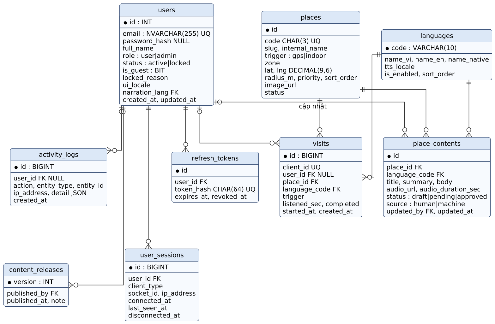

## Các bảng

CSDL có **10 bảng**: 9 bảng nghiệp vụ dưới đây và `schema_migrations` (theo dõi migration).

| Bảng | Mục đích | Cột chính và ràng buộc |
|-----------------------------------------|--------------------------------------------|--------------------------------------------------|
| **users** | Tài khoản (khách ẩn danh và quản trị viên) | id, email UNIQUE, password_hash NULL (khách không có), full_name, role CHECK (user, admin), **is_guest** BIT, status CHECK (active, locked), locked_reason, ui_locale, narration_lang FK languages, created_at, updated_at |
| **refresh_tokens** | Phiên đăng nhập dài hạn | id, user_id FK CASCADE, token_hash CHAR(64) UNIQUE (SHA-256), expires_at, revoked_at, created_at |
| **user_sessions** | **Nguồn dữ liệu presence**: mỗi kết nối realtime | id BIGINT, user_id FK CASCADE, client_type CHECK (web, admin, mobile), socket_id, ip_address, user_agent, connected_at, last_seen_at, disconnected_at; filtered index trên phiên đang mở |
| **activity_logs** | Nhật ký | id BIGINT, user_id NULL, action, entity_type, entity_id, ip_address, detail (JSON, CHECK ISJSON), created_at |
| **languages** | Ngôn ngữ thuyết minh | code PK (ISO 639-1), name_vi, name_en, name_native, tts_locale (BCP 47), is_enabled, sort_order |
| **places** | Điểm thuyết minh | id, code CHAR(3) UNIQUE, slug, internal_name, trigger_type CHECK (gps, indoor), zone CHECK, lat DECIMAL(9,6), lng DECIMAL(9,6), radius_m CHECK 15–80, priority, sort_order, image_url, status CHECK (draft, published, hidden), created_at, updated_at |
| **place_contents** | Bài thuyết minh theo ngôn ngữ | id, place_id FK CASCADE, language_code FK, title, summary, body NVARCHAR(MAX), audio_url, audio_duration_sec, audio_bytes, status CHECK (draft, pending, approved), source CHECK (human, machine), updated_by FK users NULL, updated_at; UNIQUE (place_id, language_code) |
| **content_releases** | Phiên bản nội dung | version INT IDENTITY, published_by FK users NULL, published_at, note – mỗi lần xuất bản thêm 1 dòng |
| **visits** | Lượt ghé | id BIGINT, client_id UNIQUEIDENTIFIER UNIQUE (bỏ trùng), user_id FK NULL, place_id FK, language_code, trigger_type CHECK (gps, qr, code, manual, simulated), listened_sec, completed BIT, started_at, created_at; index (place_id, started_at), (user_id, started_at), (started_at) |
| **schema_migrations** | Theo dõi migration | name, applied_at |

> **Lưu ý:** Chỉ dùng ON DELETE CASCADE ở bảng con thuần túy (refresh_tokens, user_sessions, place_contents) để tránh lỗi "multiple cascade paths" của SQL Server. Muốn xóa một người dùng phải xóa (hoặc gán NULL) ở `visits`, `activity_logs`, `place_contents.updated_by`, `content_releases.published_by` trước. Điểm đã có lượt ghé không được xóa, chỉ được ẩn. Cột `trigger_type` không tên `trigger` vì đó là từ khóa của SQL Server.

## View và stored procedure

| Đối tượng | Mục đích |
|-----------------------------------------|--------------------------------------------------|
| **v_active_users** | Người đang hoạt động: phiên chưa đóng, nhịp tim ≤ 60 giây; một dòng/người kèm is_guest, open_sessions, on_web, on_mobile, on_admin, online_since |
| **v_user_last_seen** | Thời điểm hoạt động gần nhất của mỗi người – cột "hoạt động gần nhất" của FE-18 |
| **v_place_stats** | Lượt ghé, số người nghe, tỷ lệ nghe hết theo điểm (không tính simulated) |
| **v_language_completeness** | Mỗi ngôn ngữ: số điểm đã duyệt / chờ duyệt / thiếu |
| **sp_admin_dashboard_stats** | 5 số liệu Dashboard; "hôm nay" theo giờ Việt Nam (`AT TIME ZONE 'SE Asia Standard Time'`) |
| **sp_publish_content** | Thêm dòng content_releases, trả version mới |

## Migration và dữ liệu mẫu

| Tệp | Nội dung |
|-----------------------------------------|--------------------------------------------------|
| `001_init.sql` | Tạo bảng, ràng buộc, chỉ mục |
| `002_views_procs.sql` | 4 view, 2 stored procedure |
| `003_guest_visitors.sql` | Thêm `users.is_guest`; cập nhật `v_active_users` |
| `004_drop_tours.sql` *(cần làm)* | Xóa `tour_members`, `tours`; đổi vai trò `guide` còn sót thành `user`; thay CHECK `role IN ('user','admin')`; sửa `sp_admin_dashboard_stats` bỏ cột `active_tours` |

- Migration là tệp `.sql` đánh số, tách khối bằng `GO`, mỗi tệp chạy trong một transaction, ghi vào `schema_migrations`; đầu tệp `SET ANSI_NULLS ON; SET QUOTED_IDENTIFIER ON;`. Lệnh: `npm run db:migrate`.
- Dữ liệu mẫu (`npm run db:seed`, chạy lại an toàn): **1 quản trị viên** (`admin@demo.vn`), 6 khách mẫu (is_guest = 1); 10 ngôn ngữ; 12 điểm (Phụ lục A) × 10 ngôn ngữ (vi, en đã duyệt; 8 ngôn ngữ chờ duyệt đến khi được kiểm tra); **120 tệp giọng đọc AI**; lượt ghé mẫu 7 ngày để Dashboard có dữ liệu.
- Thời gian lưu UTC; giao diện hiển thị giờ Việt Nam.

## Mở rộng nhiều điểm đến (giai đoạn 2)

Thêm bảng `sites` và cột `places.site_id`; gói nội dung lọc theo site. Mọi truy vấn đi qua lớp repository nên bổ sung không ảnh hưởng client.

# Yêu cầu phi chức năng

| Mã | Nhóm | Yêu cầu | Cách kiểm chứng |
|-----------------|----------------------|--------------------------------------------------|---------------------------|
| NFR-01 | Độ trễ kích hoạt | Từ lúc vào vùng đến lúc phát ≤ 3 giây (GPS tốt / mô phỏng) | TC-10, test đơn vị geofence |
| NFR-02 | Độ chính xác kích hoạt | Không phát lặp khi dao động ở mép vùng; không phát sai khi vùng giao nhau | TC-11, TC-12 |
| NFR-03 | Offline | Mọi chức năng nghe hoạt động ở chế độ máy bay với ngôn ngữ đã tải | TC-20 |
| NFR-04 | Pin | Tham quan 60 phút, màn hình bật, tiêu hao ≤ 15% pin (điện thoại tầm trung) | Đo thực tế |
| NFR-05 | Khởi động | Mở ứng dụng đến màn Bản đồ có điểm ≤ 2,5 giây (đã có gói nội dung) | Đo trên Android tầm trung |
| NFR-06 | Dung lượng | APK ≤ 60 MB; gói 1 ngôn ngữ (12 điểm, MP3 48 kbps) ≤ 10 MB | Kiểm tra bản build |
| NFR-07 | Hiệu năng API | p95 < 300 ms cho `GET /places`, `/content/bundle`, `/admin/*` với 10 000 lượt ghé | autocannon |
| NFR-08 | Realtime | Cập nhật presence ≤ 3 giây khi vào/ra bình thường; ≤ 90 giây khi mất mạng đột ngột | TC-30 → TC-33 |
| NFR-09 | Khả dụng | API khởi động lại không mất dữ liệu; phiên cũ được đóng; Mobile vẫn nghe offline | TC-40 |
| NFR-10 | Tương thích | Android 10+, iOS 16+; Chrome, Edge, Safari, Firefox 2 phiên bản gần nhất; rộng 360–1920 px; Web User chạy được ở `http://IP` (không HTTPS) | Kiểm thử thiết bị |
| NFR-11 | Khả năng tiếp cận | Mục 10.5; Lighthouse Accessibility ≥ 90 cho Web User | Lighthouse |
| NFR-12 | Bảo trì | TypeScript strict; lint không lỗi; mỗi PR có review và CI xanh | CI |

# Bảo mật và quyền riêng tư

## Xác thực và phân quyền

- Mật khẩu quản trị viên băm bcrypt; khách không có mật khẩu (`password_hash = NULL`) nên không thể đăng nhập bằng email khách.
- Access token JWT HS256 15 phút; refresh token ngẫu nhiên 256 bit, CSDL chỉ lưu SHA-256, xoay vòng mỗi lần làm mới; dùng lại token đã thu hồi → thu hồi mọi phiên của người đó.
- Web: refresh token trong cookie HttpOnly SameSite=Lax + chống CSRF double-submit; Mobile: expo-secure-store.
- Giới hạn tốc độ: 10 lần đăng nhập sai / 15 phút / IP; giới hạn tạo khách theo IP (chống tạo hàng loạt); thông báo lỗi không tiết lộ email có tồn tại.
- Kiểm tra quyền ở Backend cho mọi route (`requireAuth`, `requireRole("admin")`).
- Khóa tài khoản → thu hồi phiên và đăng xuất realtime (UC-13).

## Dữ liệu và tệp

- Mọi truy vấn SQL dùng tham số; kiểm tra đầu vào bằng zod.
- Tệp tải lên: kiểm tra MIME và phần mở rộng, giới hạn dung lượng (ảnh 5 MB, âm thanh 20 MB), tên tệp do máy chủ sinh; chỉ admin được tải.
- Helmet (CSP, HSTS khi HTTPS); CORS chỉ cho origin của Web User/Web Admin (và địa chỉ tunnel khi trình diễn).
- Nhật ký không ghi mật khẩu, token (pino redact).
- Tệp `api/.env` chứa `DB_PASSWORD`, `JWT_*` **không bao giờ commit**; chỉ commit `.env.example`. Ảnh chụp màn hình gửi đi phải che mật khẩu.

## Quyền riêng tư vị trí

- **Tọa độ GPS không rời khỏi thiết bị.** Máy chủ chỉ nhận lượt ghé (điểm nào, lúc nào).
- Chỉ xin quyền vị trí "Khi dùng ứng dụng"; giải thích trước khi hệ thống hỏi; từ chối vẫn dùng được QR/số điểm.
- Khách ẩn danh không cung cấp tên, email hay số điện thoại.
- Địa chỉ IP trong `user_sessions` / `activity_logs` chỉ admin xem, phục vụ an ninh.

## Nội dung và giọng đọc

- Nội dung lịch sử phải được đối chiếu nguồn chính thức (trang Di tích Dinh Độc Lập, bảng thuyết minh tại chỗ) trước khi chuyển "Đã duyệt". Tầng của từng phòng và tọa độ cần xác nhận tại chỗ khi có điều kiện.
- Ảnh phải có quyền sử dụng; nguồn ghi trong `CREDITS.md`.
- Giọng đọc AI sinh bằng `edge-tts`, thư viện mã nguồn mở gọi dịch vụ đọc của trình duyệt Microsoft Edge; **không phải API thương mại chính thức**, chỉ dùng cho mục đích học tập. Khi triển khai thật: chuyển sang dịch vụ có giấy phép (Azure AI Speech, Google Cloud TTS) – script sinh tệp tách riêng nên chỉ cần đổi một hàm.
- Trang Giới thiệu ghi rõ "Giọng đọc được tạo bằng AI".

# CI/CD (GitHub Actions)

## Quy trình nhánh

- `main`: bản ổn định để trình diễn/phát hành; chỉ nhận PR từ `develop`.
- `develop`: tích hợp; nhận PR từ nhánh tính năng.
- Nhánh: `feature/FE-xx-mo-ta`, `fix/...`, `docs/...`, `ci/...` tạo từ `develop`.
- Commit theo Conventional Commits: `feat(mobile): …`, `fix(api): …`, `docs(prd): …`.
- **Bảo vệ nhánh** `main` và `develop`: bắt buộc CI xanh (status check `test`) và ≥ 1 Approve **của người khác tác giả**; cấm push trực tiếp.

## Pipeline

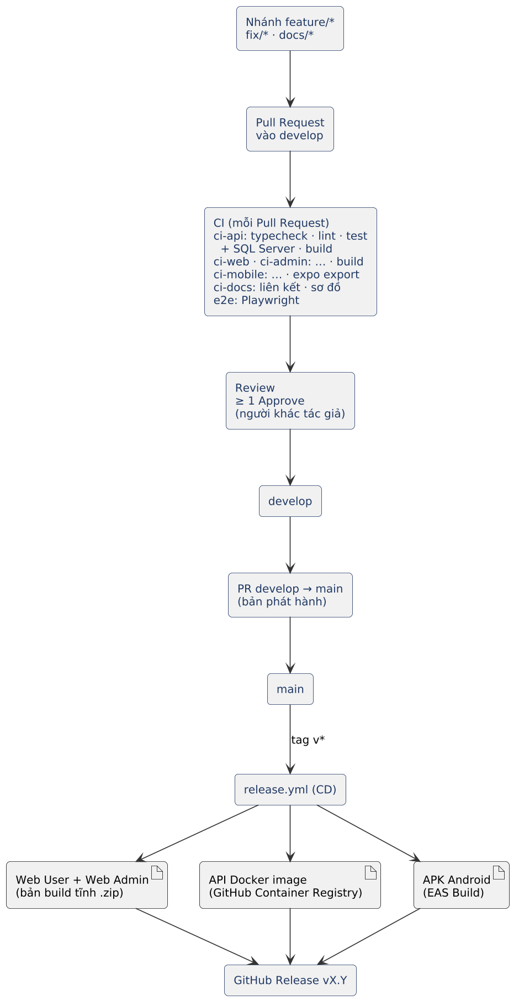

| Workflow | Kích hoạt | Các bước | Hiện trạng |
|----------------------------------|-------------------------|--------------------------------------------------|---------------|
| `ci-api.yml` | PR/push khi đổi `api/**`, `db/**` | Node 22 → npm ci → typecheck → lint → **SQL Server 2022 service container** → migrate → test (đơn vị + tích hợp) → build | Đã có |
| `ci-web.yml` | đổi `web/**` | npm ci → typecheck → lint → test (Vitest) → build | Đã có |
| `ci-admin.yml` | đổi `admin/**` | npm ci → typecheck → lint → test → build | Đã có |
| `ci-mobile.yml` | đổi `mobile/**` | npm ci → typecheck → test (geofence, narration, qr, i18n, auth) → `expo export` | Đã có |
| `ci-docs.yml` | đổi `docs/**`, `*.md` | Kiểm tra liên kết tương đối trong README; mỗi `.puml` có `.png` | Đã có |
| `e2e.yml` | PR vào `develop`, `main` | SQL Server + API + Web User + Web Admin → Playwright: TC-E1 → TC-E4 (mục 17.2) | *Cần làm* |
| `release.yml` | Gắn tag `v*` trên `main` | Build Web User, Web Admin → `.zip`; build Docker image API → GHCR; EAS Build APK (profile `preview`); tạo GitHub Release đính kèm tất cả | *Cần làm* |

## Bí mật và môi trường

- Bí mật (`EXPO_TOKEN` cho EAS, mật khẩu SQL của CI) lưu trong GitHub Secrets; `GITHUB_TOKEN` dùng để đẩy image GHCR.
- Môi trường: development (máy cá nhân), ci, demo (máy nhóm + Cloudflare Tunnel). Biến công khai của client (`VITE_*`, `EXPO_PUBLIC_*`) không chứa bí mật.
- Chạy trình diễn: `cd api && npm run demo` – chạy API, Web User, Web Admin, Cloudflare Tunnel và mở sẵn các tab khách ảo (mỗi tab một tên miền → một khách).

# Kiểm thử

## Chiến lược

| Mức | Phạm vi | Công cụ | Khi chạy |
|---------------|--------------------------------------------------|--------------------------------|-------------------------------|
| Đơn vị | Haversine, máy trạng thái geofence, bộ điều phối phát, phân tích QR, i18n, single-flight làm mới token, `uuidV4` | Vitest (mobile, web, admin, api) | Mỗi PR |
| Tích hợp API | Mọi endpoint trên SQL Server thật: khách ẩn danh, xác thực admin, nội dung, gói offline, lượt ghé, presence, admin | Vitest + supertest + SQL Server | Mỗi PR (ci-api) |
| Giao diện | Thành phần và trang chính | Testing Library | Mỗi PR |
| Đầu cuối (E2E) | Luồng chính trên trình duyệt | Playwright | PR vào develop/main (*cần làm*) |
| Thiết bị thật | APK trên Android; Expo Go; Web User trên điện thoại qua QR | Điện thoại nhóm | Trước báo cáo |

## Test case chính

| Mã | Tình huống | Kết quả mong đợi | Liên quan |
|---------------|--------------------------------------------------|--------------------------------------------------|-----------------|
| TC-01 | Mở Mobile lần đầu → Bắt đầu → tiếng Anh → nghe điểm 001 | Phát được, không yêu cầu đăng ký | FE-01 |
| TC-02 | Đóng và mở lại ứng dụng / tải lại Web User | Vẫn là khách cũ, không tạo khách mới | FE-01, FE-16 |
| TC-03 | Tìm ngôn ngữ "nhat", "japanese", "日本", "ja" | Đều ra tiếng Nhật | FE-02 |
| TC-04 | Từ chối quyền vị trí | Bản đồ vẫn hiện điểm, banner hướng dẫn, QR dùng được | FE-03 |
| TC-10 | Lộ trình mô phỏng qua 5 điểm ngoài trời | Phát đúng thứ tự, mỗi điểm 1 lần, ≤ 3 giây sau khi vào vùng | FE-05, NFR-01 |
| TC-11 | Dao động quanh mép vùng (nhiễu ±8 m) trong 60 giây | Không phát lặp | FE-05, NFR-02 |
| TC-12 | Hai vùng giao nhau, ưu tiên khác nhau | Phát điểm ưu tiên cao hơn | FE-05 |
| TC-13 | Vào vùng khi đang phát bài khác | Không cắt ngang; thẻ "Nghe ngay"; tự phát khi bài cũ hết nếu còn trong vùng | FE-05, FE-07 |
| TC-14 | Quay lại điểm vừa nghe trong 10 phút | Không tự phát lại | FE-05 |
| TC-15 | Mẫu GPS sai số 60 m | Bị bỏ qua; "GPS yếu" sau 10 giây | FE-05 |
| TC-16 | Quét QR điểm 201 trong ứng dụng / bằng camera khi chưa cài | Mở và phát đúng điểm / mở trang Web User | FE-06, FE-14 |
| TC-17 | Nhập số điểm 209 | "Không tìm thấy điểm 209" | FE-06 |
| TC-18 | Phát điểm có tệp giọng AI; xóa tệp rồi phát lại | Phát tệp, tua được / chuyển sang giọng thiết bị đúng locale | FE-07 |
| TC-19 | Đổi ngôn ngữ giữa chừng (Mobile và Web User) | Phát lại từ đầu bằng ngôn ngữ mới; không chồng âm; không trắng trang | FE-07, FE-14 |
| TC-20 | Tải gói + âm thanh tiếng Anh → chế độ máy bay → tham quan 12 điểm | Mọi chức năng nghe hoạt động; lượt ghé gửi đủ khi có mạng, không trùng | FE-08, NFR-03 |
| TC-21 | Admin duyệt và xuất bản bài mới | Mobile nhận bản mới khi mở lại (version tăng) | FE-08, FE-21 |
| TC-22 | Nghe đủ 12 điểm | Tiến độ 12/12, hộp thoại chúc mừng | FE-09 |
| TC-23 | Mở Lịch sử trên Mobile sau khi nghe 3 điểm | 3 dòng đúng thứ tự thời gian, đúng cách kích hoạt | FE-10 |
| TC-24 | Đổi cỡ chữ Lớn, tắt rung | Văn bản to hơn ở chi tiết và trình phát; vào vùng không rung | FE-12 |
| TC-30 | 4 điện thoại quét QR mời tham gia | Web Admin hiện 4 khách đang hoạt động ≤ 3 giây | FE-19, FE-23 |
| TC-31 | `npm run demo` mở 4 tab khách ảo | 4 khách khác nhau (localhost, 127.0.0.1, IP Wi-Fi, tunnel) | FE-19 |
| TC-32 | Khách tắt mạng đột ngột | Rời danh sách đang hoạt động ≤ 90 giây | FE-19 |
| TC-33 | Một khách mở 2 tab cùng tên miền | Đang hoạt động vẫn tính 1, số phiên = 2 | FE-19 |
| TC-34 | Admin khóa khách đang trực tuyến | Thiết bị báo bị khóa ≤ 3 giây, không tạo khách mới; có nhật ký | FE-18 |
| TC-35 | Admin thêm điểm mới bằng bản đồ + bài tiếng Việt | Hoàn thành ≤ 5 phút; xuất hiện trên Mobile sau cập nhật | FE-20 |
| TC-36 | Tải tệp 25 MB / tệp .exe đổi tên .mp3 | 413 / 415, báo lỗi tại trường | FE-21 |
| TC-37 | Thêm ngôn ngữ Italiano, viết 1 bài, duyệt | Khách tìm thấy và nghe được | FE-22 |
| TC-38 | In mã QR các phòng | QR quét được bằng camera thông thường | FE-24 |
| TC-40 | Khởi động lại API khi đang có người dùng | Phiên cũ đóng; Mobile vẫn nghe offline; kết nối lại tự động | NFR-09 |
| TC-41 | Khách gọi `/admin/*`; gọi `/auth/register`, `/tours` | 403; 404 | Mục 15 |
| TC-E1 | (Playwright) Mở Web User → chọn tiếng Anh → mở `/p/201` → bấm Nghe | Có tiêu đề tiếng Anh, `POST /visits` thành công | FE-13, FE-14 |
| TC-E2 | (Playwright) Hai context trình duyệt mở Web User; Admin mở Đang hoạt động | Admin hiện ≥ 2 khách | FE-19 |
| TC-E3 | (Playwright) Admin đăng nhập → sửa tóm tắt điểm 001 tiếng Anh → Web User thấy nội dung mới | Nội dung khớp | FE-21 |
| TC-E4 | (Playwright) Admin khóa một khách đang mở Web User | Tab khách hiện thông báo bị khóa | FE-18 |

## Tiêu chí hoàn thành (Definition of Done)

- Đáp ứng tiêu chí chấp nhận; có test cho logic mới; CI xanh.
- Người còn lại review và Approve; cập nhật Swagger (nếu đổi API) và PRD nếu đổi hành vi.
- Giao diện kiểm tra trên điện thoại thật (Mobile) hoặc ở 360 px và 1280 px (web).

# Kế hoạch hoàn thiện

## Hiện trạng (01/11/2026)

- Đã có: toàn bộ FE-01 → FE-24 ở mức chạy được, trừ các mục ghi *Cần làm*; 5 workflow CI; 12 điểm × 10 ngôn ngữ nội dung (vi, en đã duyệt); ảnh 12 điểm; khách ẩn danh; demo nhiều khách qua tunnel.
- Đã qua buổi kiểm tra giữa kỳ (28/10). Báo cáo cuối kỳ dự kiến **15–20/11/2026**.

## Kế hoạch 2 tuần

| # | Thời gian | Công việc (nhánh) | Kết quả bàn giao |
|--------|----------------------|--------------------------------------------------|---------------------------------------------|
| 1 | 01–02/11 | PRD v2.0 (`docs/prd-v2.0`) | Tài liệu này + sơ đồ |
| 2 | 02–03/11 | Dọn nhóm tham quan (`chore/remove-tours`): migration 004, xóa module `tours`, `/auth/register`, `/me/tour`, `active_tours`, `guide`; seed 1 admin + 6 khách mẫu; xóa tài khoản thử còn sót; sửa dòng hướng dẫn QR (FE-23) | CI xanh, TC-41 đạt |
| 3 | 03–05/11 | Nội dung: rà soát bản dịch 8 ngôn ngữ → duyệt; `npm run gen:audio` sinh 120 MP3; seed nạp âm thanh (`feature/ai-voice`) | 120 bài có tệp, Dashboard "Bài chờ duyệt" = 0 |
| 4 | 05–07/11 | Mobile: FE-10 Lịch sử, rung (expo-haptics), cỡ chữ, màn chúc mừng, ẩn mô phỏng ở bản production (`feature/FE-10-history`, `feature/FE-12-settings`) | TC-22 → TC-24 đạt |
| 5 | 07–09/11 | CD: `release.yml`, `eas.json`, Dockerfile API (`ci/release`); tag `v1.0.0` | GitHub Release có zip web, image API, APK |
| 6 | 09–11/11 | E2E: `e2e.yml` + 4 kịch bản Playwright (`ci/e2e`) | TC-E1 → TC-E4 xanh |
| 7 | 11–13/11 | Kiểm thử trên điện thoại thật, sửa lỗi; cập nhật ảnh giao diện trong PRD | Danh sách lỗi = 0 mức cao |
| 8 | 13/11 | **Đóng băng code** (chỉ sửa lỗi nghiêm trọng); gộp develop → main, tag `v1.0.x` | Bản trình diễn cuối |
| 9 | 13–báo cáo | Báo cáo Word, slide, tập dượt theo Phụ lục D | Hồ sơ nộp |

## Phân công

| Thành viên | Đã làm (giai đoạn 22/10 – 31/10) | Giai đoạn hoàn thiện |
|----------------|--------------------------------------------------|--------------------------------------------------|
| **Lương Diệu Quang** | Backend + CSDL; lõi Mobile (vị trí, geofence, trình phát, offline); Web Admin; CI; khách ẩn danh, presence, demo tunnel | **Review và Approve** mọi PR; trả lời câu hỏi kỹ thuật; tập dượt phần kiến trúc |
| **Võ Thị Ngọc Như** | Web User; màn hình Mobile; README; kiểm thử trên điện thoại | **Thực hiện và commit** các việc #1 → #7; duyệt bản dịch; tập dượt phần trình diễn |

> **Lưu ý:** Mỗi việc một nhánh và một Pull Request vào `develop`; người còn lại review. Lịch sử commit phản ánh đúng phân công.

## Rủi ro

| Rủi ro | Mức | Phòng tránh / ứng phó |
|------------------------------------------------|---------------|--------------------------------------------------|
| Không trình diễn được tại Dinh Độc Lập | Cao | Chế độ mô phỏng (FE-11) với lộ trình mẫu; QR in sẵn cho điểm trong nhà |
| Wi-Fi phòng báo cáo chặn kết nối giữa thiết bị | Trung bình | Cloudflare Tunnel (4G vẫn vào); phát Wi-Fi từ điện thoại; Mobile vẫn nghe offline |
| Tunnel chậm khi Vite ở chế độ dev | Trung bình | Trình diễn bằng bản build (`vite preview`) hoặc mạng nội bộ |
| GPS sai lệch, phát nhầm | Trung bình | Lọc sai số, dwell, hysteresis, cooldown; bán kính ≥ 15 m; trong nhà dùng QR |
| Dịch vụ edge-tts thay đổi/không truy cập được | Thấp | Tệp MP3 đã commit vào kho; dự phòng giọng thiết bị |
| Bản dịch 8 ngôn ngữ chưa chính xác | Trung bình | Để "chờ duyệt" có nhãn cho tới khi kiểm tra; ưu tiên vi/en khi trình diễn |
| EAS Build cần tài khoản Expo, khóa Google Maps | Trung bình | Tạo tài khoản Expo trước 07/11; dự phòng trình diễn bằng Expo Go |
| Máy chạy SQL Server hết dung lượng / dịch vụ tắt | Trung bình | Sao lưu `BACKUP DATABASE` trước ngày báo cáo; kiểm tra dịch vụ SQLEXPRESS, TCP 1433 |
| Thiếu thời gian | Cao | Làm theo thứ tự bảng 18.2; việc "Nên" làm sau cùng; đóng băng code 13/11 |

## Câu hỏi mở (giai đoạn 2)

- Có được đặt biển QR tại các phòng thật không, hay dùng số điểm sẵn có của Dinh?
- Có cần tự thuyết minh khi chạy nền (ảnh hưởng quyền và pin)?
- Chuyển giọng đọc sang dịch vụ có giấy phép khi triển khai thật?

# Phụ lục A. Danh sách điểm thuyết minh

Tọa độ là **giá trị ước lượng** cho dữ liệu mẫu và mô phỏng; cần đo lại tại chỗ. Điểm indoor có tọa độ để hiện trên bản đồ, không dùng để tự phát.

| Số | Tên điểm | Kích hoạt | Khu vực | Tọa độ (lat, lng) | Bán kính | Nội dung chính |
|----------|---------------------------|-----------------|-----------------|---------------------------|------------|--------------------------------------------------|
| 001 | Cổng chính – đại lộ Lê Duẩn | gps | Ngoài trời | 10.778350, 106.696700 | 30 m | Lịch sử khu đất; khánh thành 31/10/1966; trưa 30/4/1975 xe tăng tiến qua cổng |
| 002 | Hai xe tăng 390 và 843 | gps | Ngoài trời | 10.777900, 106.696400 | 25 m | Thời khắc trưa 30/4/1975 |
| 003 | Bãi cỏ và đài phun nước | gps | Ngoài trời | 10.777550, 106.696050 | 30 m | Cảnh quan trục chính, nơi tổ chức nghi lễ |
| 004 | Mặt tiền tòa nhà | gps | Ngoài trời | 10.777250, 106.695650 | 25 m | Kiến trúc của KTS Ngô Viết Thụ, rèm hoa đá |
| 005 | Khuôn viên phía sau | gps | Ngoài trời | 10.776400, 106.694800 | 30 m | Cây xanh, khu vực phía sau tòa nhà |
| 101 | Hội trường Thống Nhất | indoor | Tầng trệt | 10.777000, 106.695400 | – | Hội nghị Hiệp thương chính trị thống nhất đất nước (11/1975) |
| 102 | Phòng họp Nội các | indoor | Tầng trệt | 10.777050, 106.695250 | – | Phòng họp của chính quyền Sài Gòn trước 1975 |
| 103 | Phòng Khánh tiết | indoor | Tầng trệt | 10.776950, 106.695550 | – | Nơi tổ chức tiệc chiêu đãi, tiếp đón |
| 201 | Phòng Trình Quốc thư | indoor | Lầu 1 | 10.777000, 106.695350 | – | Nơi đại sứ trình Quốc thư; bức sơn mài lớn |
| 202 | Phòng làm việc Tổng thống | indoor | Lầu 1 | 10.776950, 106.695200 | – | Không gian làm việc của người đứng đầu chính quyền Sài Gòn |
| 401 | Sân thượng – trực thăng | indoor | Sân thượng | 10.777000, 106.695300 | – | Trực thăng UH-1; vòng tròn đỏ đánh dấu bom rơi 8/4/1975 |
| 901 | Tầng hầm – hầm chỉ huy | indoor | Tầng hầm | 10.777000, 106.695450 | – | Phòng tác chiến, trung tâm viễn thông, bản đồ quân sự |

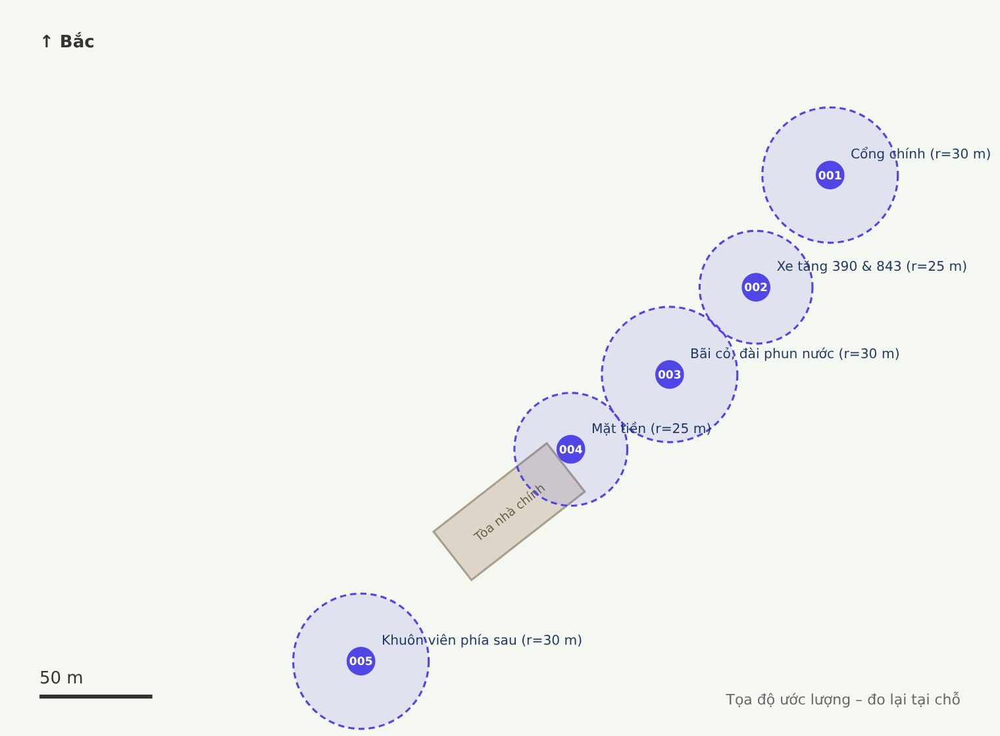

# Phụ lục B. Ngôn ngữ và giọng đọc AI

| Mã | Tên tiếng Việt | Tên bản ngữ | Locale | Giọng AI (edge-tts) | Trạng thái nội dung |
|--------|----------------------|----------------------|-----------------|-----------------------------------------|-----------------------------|
| vi | Tiếng Việt | Tiếng Việt | vi-VN | vi-VN-HoaiMyNeural | Đã duyệt |
| en | Tiếng Anh | English | en-US | en-US-JennyNeural | Đã duyệt |
| zh | Tiếng Trung (giản thể) | 中文 | zh-CN | zh-CN-XiaoxiaoNeural | Chờ duyệt → duyệt trước 05/11 |
| ko | Tiếng Hàn | 한국어 | ko-KR | ko-KR-SunHiNeural | Chờ duyệt → duyệt trước 05/11 |
| ja | Tiếng Nhật | 日本語 | ja-JP | ja-JP-NanamiNeural | Chờ duyệt → duyệt trước 05/11 |
| fr | Tiếng Pháp | Français | fr-FR | fr-FR-DeniseNeural | Chờ duyệt → duyệt trước 05/11 |
| de | Tiếng Đức | Deutsch | de-DE | de-DE-KatjaNeural | Chờ duyệt → duyệt trước 05/11 |
| ru | Tiếng Nga | Русский | ru-RU | ru-RU-SvetlanaNeural | Chờ duyệt → duyệt trước 05/11 |
| es | Tiếng Tây Ban Nha | Español | es-ES | es-ES-ElviraNeural | Chờ duyệt → duyệt trước 05/11 |
| th | Tiếng Thái | ไทย | th-TH | th-TH-PremwadeeNeural | Chờ duyệt → duyệt trước 05/11 |

Danh mục ISO 639-1 đầy đủ dùng cho "Thêm ngôn ngữ" của Web Admin nằm trong API (`GET /admin/languages/catalog`).

# Phụ lục C. Hằng số cấu hình

| Hằng số | Giá trị | Ý nghĩa |
|------------------------------------------|-----------------|--------------------------------------------------|
| LOCATION_TIME_INTERVAL_MS / DISTANCE_INTERVAL_M | 2000 / 3 | Chu kỳ và khoảng dịch chuyển tối thiểu nhận vị trí |
| MAX_ACCURACY_M | 35 | Bỏ mẫu có sai số lớn hơn |
| MAX_FIX_AGE_MS | 10000 | Bỏ mẫu cũ |
| MAX_WALK_SPEED_MPS / JUMP_CONFIRM_SAMPLES | 15 / 3 | Bỏ mẫu "nhảy"; chấp nhận khi 3 mẫu xác nhận |
| DWELL_MS / DWELL_SAMPLES | 3000 / 2 | Điều kiện xác nhận đã vào vùng |
| EXIT_HYSTERESIS_M | 10 | Vùng trễ khi ra |
| REPLAY_COOLDOWN_MS | 600000 | Không tự phát lại trong 10 phút |
| WEAK_SIGNAL_MS | 10000 | Hiện "GPS yếu" sau 10 giây không có mẫu hợp lệ |
| FAR_FROM_SITE_M | 1000 | Banner "Bạn đang ở xa Dinh Độc Lập" |
| COMPLETED_RATIO | 0.9 | Nghe ≥ 90% coi là nghe hết |
| DEFAULT_RADIUS_M / MIN / MAX | 25 / 15 / 80 | Bán kính vùng kích hoạt |
| PRESENCE_PING_MS / ACTIVE_WINDOW_S | 30000 / 60 | Presence |
| MAX_IMAGE_MB / MAX_AUDIO_MB | 5 / 20 | Giới hạn tệp tải lên |
| ACCESS_TOKEN_TTL_MIN / REFRESH_TOKEN_TTL_DAYS | 15 / 7 | Phiên đăng nhập |

# Phụ lục D. Kịch bản trình diễn (15 phút)

1. **Bối cảnh (1 phút):** vấn đề của khách quốc tế tại Dinh Độc Lập; mục tiêu sản phẩm.
2. **Khách ẩn danh + realtime (3 phút):** Web Admin → Đang hoạt động → Mời tham gia (QR); 3–4 bạn quét bằng điện thoại thật (4G qua tunnel) → bảng hiện từng khách; một khách đổi ngôn ngữ khi đang nghe.
3. **Mobile – tự động thuyết minh (4 phút):** chọn ngôn ngữ bằng tìm kiếm; tải offline; bật mô phỏng, chạy lộ trình mẫu → 5 điểm ngoài trời tự phát (giọng AI); giải thích dwell/hysteresis; bật chế độ máy bay để chứng minh offline.
4. **Mobile – trong nhà (2 phút):** quét QR điểm 201 đã in; nhập số 401; tiến độ và Lịch sử.
5. **Web Admin (3 phút):** Dashboard; sửa bài tiếng Anh, nghe thử; mức hoàn thiện ngôn ngữ; khóa một khách → thiết bị bị đăng xuất; in QR.
6. **CI/CD (2 phút):** một Pull Request với CI xanh và Approve; GitHub Release có APK.

# Phụ lục E. Bài thuyết minh mẫu

> **Cảnh báo:** Nội dung mẫu phải được đối chiếu nguồn chính thức trước khi chuyển "Đã duyệt" (mục 15.4).

**E.1. Điểm 001 – Cổng chính**

*Tiếng Việt.* Chào mừng bạn đến Dinh Độc Lập. Trước mặt bạn là cổng chính, nhìn ra đại lộ Lê Duẩn. Khu đất này từng là nơi đặt dinh thự của Thống đốc Nam Kỳ thời Pháp thuộc, được xây dựng từ năm 1868 đến năm 1873. Năm 1962, sau khi dinh cũ bị hư hại nặng trong một vụ ném bom, công trình mới được xây dựng theo thiết kế của kiến trúc sư Ngô Viết Thụ và khánh thành ngày 31 tháng 10 năm 1966. Trưa ngày 30 tháng 4 năm 1975, xe tăng Quân Giải phóng tiến qua cánh cổng này – thời khắc đánh dấu sự kết thúc của chiến tranh và mở ra thời kỳ thống nhất đất nước.

*English.* Welcome to the Independence Palace. In front of you is the main gate, facing Le Duan Boulevard. This site was once home to the residence of the French Governor of Cochinchina, built between 1868 and 1873. In 1962, after the old palace was badly damaged in a bombing, a new building designed by architect Ngo Viet Thu was constructed and inaugurated on 31 October 1966. At noon on 30 April 1975, Liberation Army tanks rolled through this gate – the moment that marked the end of the war and the reunification of Vietnam.

**E.2. Điểm 002 – Hai xe tăng 390 và 843**

*Tiếng Việt.* Hai chiếc xe tăng mang số hiệu 390 và 843 trong khuôn viên gợi lại thời khắc lịch sử trưa ngày 30 tháng 4 năm 1975. Theo các tư liệu lịch sử, xe tăng 843 húc vào cổng phụ, còn xe tăng 390 húc đổ cổng chính và tiến vào sân Dinh. Ít phút sau, lá cờ của Quân Giải phóng được cắm trên nóc Dinh.

*English.* The two tanks numbered 390 and 843 recall the historic moment at noon on 30 April 1975. According to historical records, tank 843 rammed the side gate, while tank 390 crashed through the main gate and drove into the palace grounds. Minutes later, the Liberation Army flag was raised on the roof of the palace.

**E.3. Điểm 401 – Sân thượng**

*Tiếng Việt.* Bạn đang ở sân thượng của Dinh. Chiếc trực thăng trưng bày ở đây là loại UH-1. Hãy chú ý những vòng tròn sơn đỏ trên sàn: chúng đánh dấu vị trí bom rơi trong trận ném bom Dinh ngày 8 tháng 4 năm 1975 do phi công Nguyễn Thành Trung thực hiện.

*English.* You are on the rooftop of the palace. The helicopter displayed here is a UH-1. Notice the red circles painted on the floor: they mark where bombs struck during the bombing of the palace on 8 April 1975, carried out by pilot Nguyen Thanh Trung.
